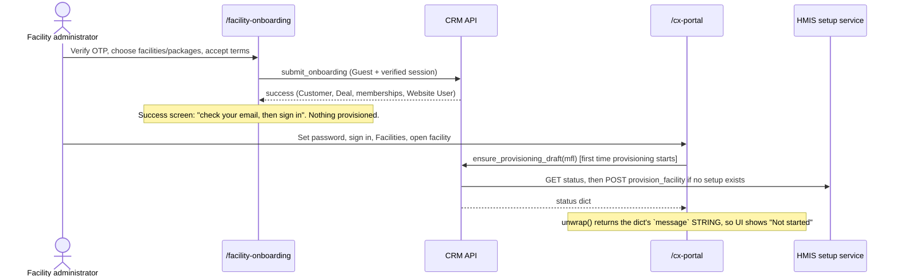
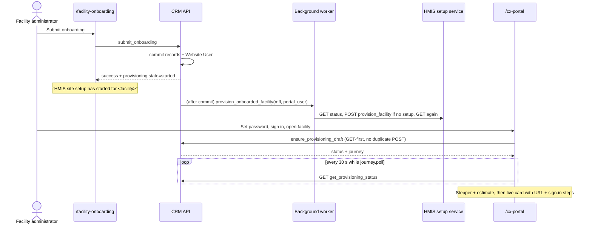

# HMIS provisioning on onboarding + implementation status revamp

**Date:** 2026-10-25
**Requested by:** maintainer
**Epic:** `hmis-provisioning`
**Canonical PRD (updated):** [`docs/hmis-implementation-prd.md`](../../../docs/hmis-implementation-prd.md) §9 (HIMS-09 to HIMS-12)
**Review format:** BMAD Party Mode round-table: Mary (Analyst), John (PM), Sally (UX), Winston (Architect), Amelia (Dev)

---

## 1. Request

1. Start HMIS site provisioning as soon as a facility administrator reaches the self-onboarding success screen. It should not wait until they sign in and open the facility. Provisioning should already be under way by the time they have set a password and signed in.
2. Revamp the Single Facility **HMIS implementation** section:
   - **Provisioned:** show the site URL and how to sign in.
   - **Not provisioned:** the status API says where setup is, and the UI shows that progress with an idea of how long the wait will be.
3. Today the section shows `Not started` / `Implementation status has not been checked.` with no actionable feedback.

## 2. As-is workflow (verified in code)

### Findings

| # | Finding | Evidence |
|---|---|---|
| F1 | **Root cause of "Not started / has not been checked":** `frappe-ui` `call()` already returns `data.message`, the status dict. `FacilityPortal.vue` `unwrap()` then prefers `response.message`, which on this dict is the human sentence (for example "Status synced from the HMIS setup service…"). `FacilitySingleView` receives a string, `status` is undefined, so the label is `Not started` and the guidance falls back to `Implementation status has not been checked.` | `frontend/node_modules/frappe-ui/src/utils/call.ts:80`, `FacilityPortal.vue unwrap()`, `FacilitySingleView.vue:88,122` |
| F2 | The Playwright regression mocks wrap status in `{message:{data:{…}}}`. The real endpoint never returns that shape, so the suite passed while production was broken. | `frontend/e2e/regression/facility-single-view.spec.ts` |
| F3 | Provisioning (`ensure_provisioning_draft`) starts only when a signed-in user opens a facility. It authorizes through `frappe.session.user`, and that user is Guest during onboarding. | `crm/api/hfr.py _get_provisioning_status` |
| F4 | Everything the setup payload needs is already persisted by `submit_onboarding`: FID and licence on the Pre-Qualified Facility and Deal Facility, the token package quantity, and the OTP-verified owner contact on the membership. So a draft can be created right after onboarding commits. | `facility_onboarding._upsert_facility_membership`, `_deal_add_facility` |
| F5 | The documented TA status contract returns `status`, `progress`, `last_attempt`, `error` and `log`. It has **no site URL, login URL or ETA**. | `docs/cx-portal-provisioning-gateway-api.md` |
| F6 | PRD rule 8: CRM creates the TA setup draft and never calls a deploy action, and no TA deploy endpoint is documented. | `docs/hmis-implementation-prd.md` §2.8 |

## 3. Party Mode review: decisions and open points

**Decided**

- **D1 (Winston):** At the end of `submit_onboarding`, enqueue one background job per facility, with `enqueue_after_commit=True`, `job_id=crm-hmis-provision:<mfl>` and `deduplicate=True`. The job switches to the new portal user (`frappe.set_user`) and calls the **same** `_get_provisioning_status(ensure_missing_draft=True)` path. Authorization, the per-FID lock, payload validation and duplicate control are unchanged. There is no second write path.
- **D2 (John/Winston):** A failure to enqueue or run the job never fails onboarding. It is logged. The facility page's ensure-on-open remains the safety net.
- **D3 (Mary/Amelia):** Fix `unwrap()` so it never returns a string `message` as data. Fix the regression mocks to use the real envelope `{message:{…status…}}`.
- **D4 (Winston):** Add a backend-normalized `journey` to every status response: phase, steps, progress, wait estimate, live site and `poll`. It is a pure function with unit tests. The UI renders it and does not guess.
- **D5 (Mary):** Read the site URL, login URL, admin username and ETA from TA only when TA reports them (tolerant field aliases). Never invent them. A site URL must be `https://` with a host and no embedded credentials. This is documented as a TA contract follow-up.
- **D6 (Winston/Sally/Mary):** The wait estimate is layered, and the UI shows which source it used:
  1. a TA-reported ETA;
  2. extrapolation from TA `progress` and elapsed time since `started_at`/`last_attempt`;
  3. the configured **Typical HMIS setup time (minutes)** in CRM HFR Settings, default 30.
- **D7 (Amelia):** While setup is in progress, the view re-polls the **read-only** GET `get_provisioning_status` every 30 s. It stops on live, attention or unmount. Ensure (the write) runs only on open and on explicit retry.
- **D8 (Sally):** The success screen says setup **has started**, never that the site is **ready**.

**Open — maintainer decision required**

- **Q1 (John vs Winston, unresolved):** "This involves a deployment." CRM still only creates the TA setup request (PRD rule 8). If drafts must deploy automatically, TA has to either auto-deploy on draft creation or publish a deploy method that CRM may call. That is a product and TA change, not a CRM-only change.
- **Q2 (Mary):** Confirm the 30-minute typical setup time, or set the real figure in HFR Settings.
- **Q3 (Mary):** Ask TA to add `site_url` (plus optional `login_url`, `admin_username`, `eta_minutes`/`estimated_completion`, `started_at`) to `get_provision_status`. Until TA does, the live card shows status and login instructions without a link.

**Maintainer answers (2026-10-25)**

- **Q1:** deployment is done on a separate site. CRM only needs to poll, roughly every 5 minutes, to see whether the site has been provisioned. Implemented as a 5-minute read-only poll; CRM never deploys.
- **Q2:** typical setup time is 1 hour and must stay editable. Implemented as a setting with default 60.
- **Q3:** the provisioning team will be asked to return everything CRM needs. The list and the proposed payload are in `docs/hmis-provisioning-status-api-requirements.md`.
- No PII (URLs, user emails or facility names) in code, docs or the PR.

## 4. To-be workflow

### Journey phases

| Phase | Trigger | Polls | UI |
|---|---|---|---|
| `preparing` | `not_submitted` with no blocker, or submission `unknown` | yes | Step 1 current; estimate |
| `queued` | `Draft`/`Pending`/`Queued`, or draft created/exists | yes | Step 1 done, step 2 current |
| `deploying` | `Deploying`/`In Progress`/`Provisioning`/unknown non-error status | yes | Step 2 current, progress bar |
| `configuring` | `Configuring`/`Setting Up`/`Post Deploy` | yes | Step 3 current |
| `live` | `Deployed`/`Live`/`Active`/`Completed`/`Ready` | no | Site URL, Open HMIS, sign-in steps |
| `blocked` | submission `blocked` | no | Missing fields; check again |
| `needs_attention` | `Error`/`Failed`, `needs_support`, submission `error` | no | Diagnostics, support |
| `unavailable` / `not_linked` / `not_configured` | existing states | no | Existing retry/support copy |

## 5. Stories

Order follows STORY-RULES rule 3: schema, then backend, then frontend, then wiring and tests.

### HMIS-09-S1 — Typical setup time setting (S)

- **Files to modify:** `crm/fcrm/doctype/crm_hfr_settings/crm_hfr_settings.json` (primary), `crm/api/hfr.py` (get/update settings), `frontend/src/components/Settings/HFRSettings.vue`
- **Depends on:** None. **Blocks:** S2.
- **AC:** After `bench migrate`, `get_hfr_settings()` returns `provisioning_typical_minutes` (default 30). `update_hfr_settings` saves a positive integer and rejects negatives by clamping to 0. A value of 0 hides the typical estimate.

### HMIS-10-S2 — Backend journey normalization (M)

- **Files to modify:** `crm/api/hfr.py` (primary)
- **Files to create:** none (tests in S5)
- **Depends on:** S1. **Blocks:** S4.
- **AC:**
  - Every `get_provisioning_status`/`ensure_provisioning_draft` response includes `journey` with `phase`, `headline`, `detail`, `steps[]`, `progress`, `estimate{minutes,source,label}`, `site` and `poll`.
  - A `Deployed` status whose `site_url` is a bare host name yields an https `journey.site.url`.
  - `javascript:`/`http:`/credential URLs are dropped.
  - `Deploying` at progress 50 after 10 minutes yields an estimate of 10 minutes from source `progress`.

### HMIS-11-S3 — Start provisioning when onboarding commits (M)

- **Files to modify:** `crm/api/facility_onboarding.py` (primary), `crm/api/hfr.py` (`provision_onboarded_facility` job)
- **Depends on:** None. **Blocks:** S4.
- **AC:**
  - `submit_onboarding` calls `frappe.enqueue` once per facility with `enqueue_after_commit=True`, `deduplicate=True` and `job_id="crm-hmis-provision:<mfl>"`, and returns `provisioning.state == "started"`.
  - An enqueue exception yields `provisioning.state == "deferred"` while onboarding still succeeds.
  - The job calls ensure as the portal user and restores the previous user.

### HMIS-12-S4 — Implementation section revamp and success screen (L)

- **Files to modify:** `frontend/src/pages/FacilityPortal/FacilitySingleView.vue` (primary), `frontend/src/pages/FacilityPortal/FacilityPortal.vue` (unwrap fix + GET poll helper), `frontend/src/pages/FacilityOnboarding/FacilityOnboardingLanding.vue` (success panel)
- **Depends on:** S2, S3. **Blocks:** S5.
- **AC:**
  - A real envelope `{message:{status:'Deployed',…}}` renders `Live`, not `Not started`.
  - The live card shows the URL, an `Open HMIS` link (`target=_blank`, `rel=noopener`) and numbered sign-in steps that name the admin email.
  - In progress, the view shows a 4-step stepper, a progress bar and an estimate label, and polls GET `get_provisioning_status`.
  - The success screen lists "HMIS site setup has started" per facility when `provisioning.state == "started"`.

### HMIS-12-S5 — Regression coverage (M)

- **Files to modify:** `crm/tests/test_hfr_provisioning_status.py` (primary), `frontend/e2e/regression/facility-single-view.spec.ts`, `frontend/e2e/regression/facility-onboarding-network.spec.ts`
- **Depends on:** S4.
- **AC:**
  - `bench --site <site> run-tests --module crm.tests.test_hfr_provisioning_status` passes.
  - `npx playwright test -c playwright.facility.config.ts` passes, including live, in-progress (poll), blocked, real-envelope and success-screen cases.
  - `yarn test:run` passes.

## 6. Out of scope / follow-up

- Calling a TA deploy action (Q1).
- TA status contract additions (Q3).
- Re-trying a failed onboarding-time job on a schedule. The next facility open, or the poll, re-runs ensure.
- Opt-In (OIS) onboarding path. This change targets self-onboarding `submit_onboarding`.
