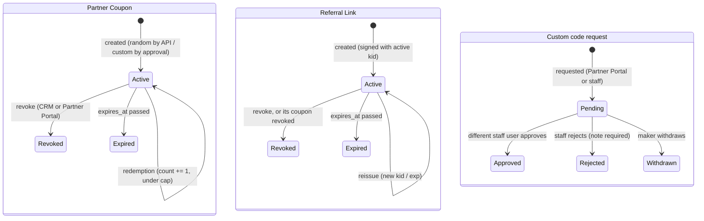
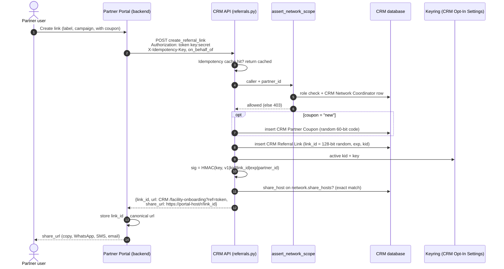
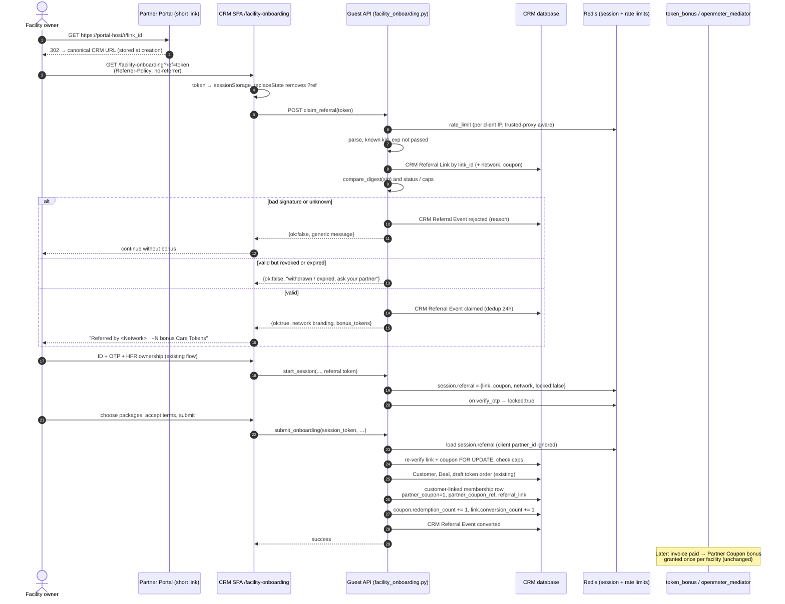
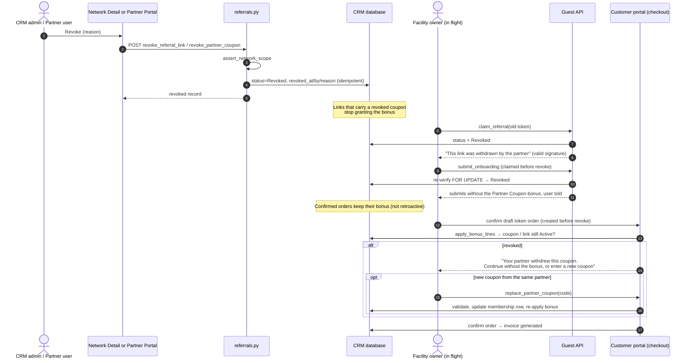
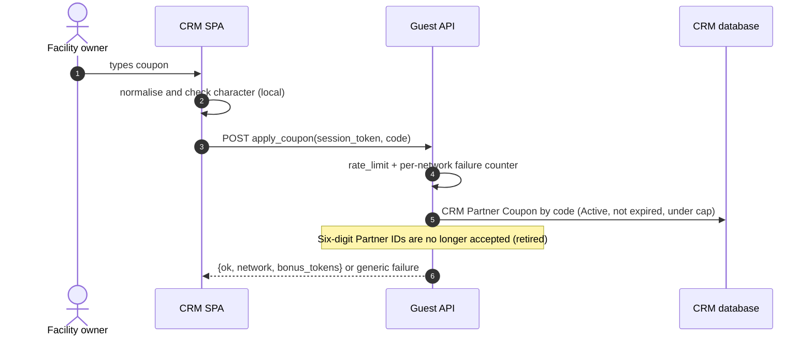
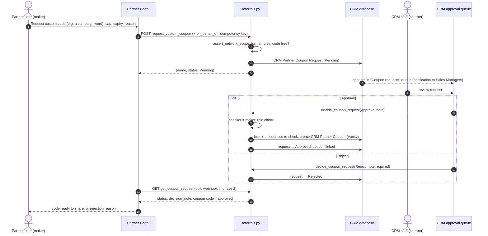
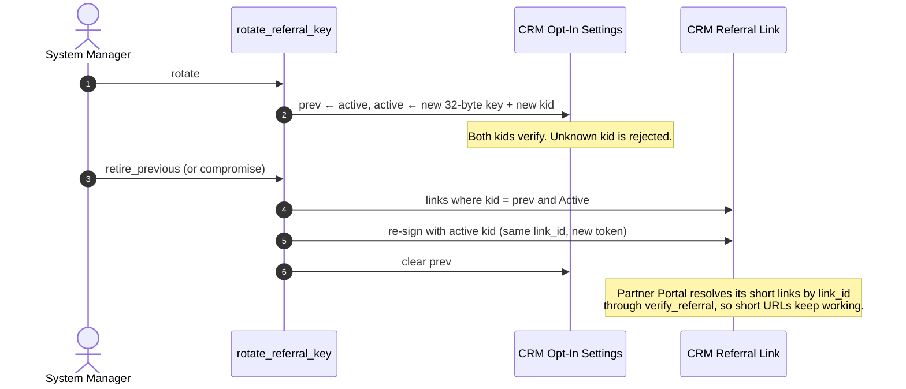

# Partner referral links and revocable Partner Coupons

## 1. Goal

- A partner (from the Partner Portal or the CRM) can create, list and revoke **Partner
  Coupon codes** and **referral links** for their network.
- A facility owner who opens a referral link, or types a coupon, is attributed to that partner's
  network on the CRM and earns the Partner Coupon bonus. That is the existing customer-linked
  membership row with `partner_coupon = 1`, and the existing once-per-facility bonus paid on the
  invoice.
- A link shared from a **non-CRM host** can be verified by the CRM as minted for that partner,
  and it resists tampering, forgery, enumeration, replay for extra benefit, and phishing reuse.
- All management happens in the CRM. The Partner Portal calls CRM APIs and holds no secrets
  beyond its own API key.

**Not in phase 1:** partner commissions or payouts, a conversion webhook to the portal, QR
generation (the client renders it from the returned URL).

## 2. Concepts

| Concept | What it is | Revocable | Typable |
|---|---|---|---|
| Network (`CRM Opt-In Network`) | Who the facility belongs to. Six-digit `partner_id`. | No (disable only) | — |
| **Partner Coupon** (`CRM Partner Coupon`) | An entitlement to the Partner Coupon bonus, scoped to one network | Yes | Yes |
| **Referral Link** (`CRM Referral Link`) | A signed, trackable link that attributes to a network and may carry a coupon | Yes | No |
| Referral event (`CRM Referral Event`) | One claim, rejection or conversion, for audit and stats | — | — |
| Coupon request (`CRM Partner Coupon Request`) | A maker-checker request for a custom (vanity) code, from the Partner Portal or CRM staff | Approve / Reject | — |
| ~~Legacy coupon~~ | The six-digit Partner ID. **Retired now** (Q2): no longer accepted | — | — |

## 3. Data model

### 3.1 `CRM Partner Coupon` (new DocType, `autoname: hash`)

| Field | Type | Notes |
|---|---|---|
| `network` | Link → CRM Opt-In Network, reqd, indexed | Owner |
| `code` | Data, unique, indexed | Normalised: upper case, no separators. Shown grouped `XXXX-XXXX-XXXX-C` |
| `code_kind` | Select `Random\nVanity` | Vanity codes exist only through an approved `CRM Partner Coupon Request` (§3.7) |
| `label` | Data | Partner's own label, for example a campaign |
| `status` | Select `Active\nRevoked\nExpired` | `Expired` set by the scheduler, or lazily on read |
| `valid_from`, `expires_at` | Datetime | `expires_at` required for Vanity |
| `max_redemptions` | Int (0 = unlimited) | Required (> 0) for Vanity |
| `redemption_count` | Int, read only | Incremented under a row lock at submit |
| `first_order_only` | Check, default 1 | Mirrors the existing once-per-facility bonus |
| `source` | Select `CRM\nPartner Portal API` | |
| `external_ref` | Data, indexed | The portal's id, unique per network |
| `created_by_actor` | Data | `on_behalf_of` from the API (partner user), or the session user |
| `revoked_at`, `revoked_by`, `revoke_reason` | Datetime, Data, Small Text | |

### 3.2 `CRM Referral Link` (new DocType)

(Coupon field `approved_request`: Link → CRM Partner Coupon Request, set on Vanity codes.)


| Field | Type | Notes |
|---|---|---|
| `link_id` | Data, unique, indexed | `secrets.token_urlsafe(16)`, 128 bits, 22 chars |
| `network` | Link, reqd, indexed | |
| `coupon` | Link → CRM Partner Coupon | Optional. Without it the link gives attribution only, no bonus |
| `label`, `campaign` | Data | |
| `status` | Select `Active\nRevoked\nExpired` | |
| `expires_at` | Datetime, reqd | Default now + `referral_link_default_days` (365). Capped at `referral_link_max_days` |
| `max_claims` | Int (0 = unlimited) | |
| `kid` | Data, read only | Key id that signed the token |
| `share_host` | Data | The registered host this link was issued for (optional) |
| `claim_count`, `conversion_count` | Int, read only | Deduplicated (§7) |
| `source`, `external_ref`, `created_by_actor`, `revoked_*` | as on coupon | |

The token is **not stored**. It can be rebuilt from `link_id`, `exp`, `kid` and the network's
Partner ID with the key. A reissue mints a new `exp`/`kid` for the same `link_id`.

### 3.3 `CRM Referral Event` (new DocType, append-only, no UI create)

`event` (`claimed`, `rejected`, `converted`, `coupon_replaced`), `referral_link`, `coupon`, `network`,
`reason` (for rejections: `bad_signature`, `unknown`, `revoked`, `expired`, `cap_reached`,
`network_disabled`, `rate_limited`), `client_hash` (HMAC-SHA256 of the client IP with
`referral_privacy_pepper`, first 16 hex chars), `ua_family`, `customer`, `facility_mfl`,
`membership` (child row name), `creation`.

### 3.4 `CRM Opt-In Network` (new child table `share_hosts`)

`CRM Partner Share Host`: `host` (Data, lower case, no scheme or path, validated as a hostname),
`enabled`. The CRM emits a `share_url` only when the requested host is on this list (exact
match), and only as `https://<host>/...`.

### 3.5 `CRM Opt-In Settings` (new section "Referral links and coupons")

| Field | Type | Default |
|---|---|---|
| `referral_signing_kid`, `referral_signing_key` | Data, Password | Generated by the patch (32 random bytes) |
| `referral_signing_prev_kid`, `referral_signing_prev_key` | Data, Password | Empty. Still verifies during rotation |
| `referral_privacy_pepper` | Password | Generated |
| `referral_attribution_days` | Int | 30 (claim TTL on a session that hasn't started) |
| `referral_link_default_days`, `referral_link_max_days` | Int | 365, 730 |
| `referral_event_retention_days` | Int | 90 (rows that never converted) |
| `partner_portal_share_base_path` | Data | `/r/` (path the portal serves short links on) |

### 3.6 `CRM Facility Membership` (custom fields on the existing coupon row)

`partner_coupon_ref` (Link → CRM Partner Coupon), `referral_link` (Link → CRM Referral Link),
`attribution_source` (Select `Referral Link\nCoupon\nLegacy Partner ID`; the last only labels rows created before the retirement). The `partner_coupon`
flag still drives `token_bonus._coupon_network`. **The bonus engine is unchanged.**

### 3.7 `CRM Partner Coupon Request` (new DocType, maker-checker, Q5)

| Field | Type | Notes |
|---|---|---|
| `network` | Link, reqd | |
| `requested_code` | Data | Normalised vanity code, 8–20 `[A-Z0-9]`, not all digits; uniqueness re-checked at approval |
| `label`, `expires_at`, `max_redemptions` | as on coupon | Cap and expiry required |
| `justification` | Small Text | Why the partner wants this code |
| `status` | Select `Pending\nApproved\nRejected\nWithdrawn` | |
| `source` | Select `CRM\nPartner Portal API` | |
| `requested_by_actor` | Data | `on_behalf_of` partner user, or the CRM staff user |
| `requested_by_user` | Link → User | The authenticated caller (API user or staff) |
| `decided_by`, `decided_at`, `decision_note` | Link → User, Datetime, Small Text | Note required on Reject |
| `coupon` | Link → CRM Partner Coupon | Set on approval |
| `external_ref` | Data | Portal's request id, unique per network |

Rules:
- **Maker ≠ checker.** `decided_by` must differ from `requested_by_user`, and from the staff
  user who submitted it in the CRM. The checker needs Sales Manager or System Manager.
- Only an approval creates a Vanity coupon (in the same transaction, with a uniqueness check
  under lock). Nothing else can set `code_kind = Vanity`.
- Pending requests can be withdrawn by the maker. Decided requests are immutable.
- Random codes and referral links stay self-service through the API (they are not guessable),
  so maker-checker applies to custom codes only. See §12, assumption A1.

## 4. Token and code formats

### 4.1 Referral token (D3)

```
v1.<kid>.<link_id>.<exp_b36>.<sig>
sig = base64url( HMAC-SHA256(key[kid], "v1|" + kid + "|" + link_id + "|" + exp + "|" + partner_id) )[:22]
```

- `partner_id` (the network's six digits) is **signed but not transmitted**. The verifier
  loads it from the `link_id` row, so a token cannot be moved to another network.
- 22 base64url characters of signature carry 132 bits. The whole token is about 70 characters.
- Verification order: parse → known `kid` (an unknown one is rejected, with no fallback) →
  `exp` not passed → load the row by `link_id` → recompute → `hmac.compare_digest` → check
  status, network enabled, coupon active, caps.
- The pure functions live in `crm/utils/referral_tokens.py` and have no Frappe imports:
  `sign(key, kid, link_id, exp, partner_id) -> str` and
  `parse(token) -> ParsedToken | None`, `verify(parsed, key, partner_id, now) -> bool`.

### 4.2 Coupon code (D8)

- Random: 12 characters of Crockford base32 (`0-9A-Z` without `ILOU`), 60 bits, from
  `secrets`, plus 1 mod-37 check character. Displayed as `XXXX-XXXX-XXXX-C`.
- On input: upper case, strip spaces and `-`, map `I`/`L`→`1` and `O`→`0`. A bad check
  character is rejected locally before any database lookup, which also catches typos.
- Vanity: 8–20 characters `[A-Z0-9]`, unique across all networks, never all digits, cap and
  expiry required. Created **only by approving a coupon request** (§3.7).

## 5. Verification: tying an off-domain link to a partner

Four layers. Each one alone is weaker than all four together.

1. **CRM signature.** Only the CRM holds the keys, and the network's Partner ID is bound into
   the MAC. A portal or attacker cannot mint or retarget a link.
2. **Ownership row.** `link_id` → `CRM Referral Link.network`, checked live. Revocation and
   expiry take effect immediately.
3. **Registered share host.** The CRM returns `share_url = https://<host><base_path><link_id>`
   only for a host on the network's `share_hosts`. Partners can show admins which hosts are
   authorised, and an unregistered host never gets an official URL.
4. **Server-to-server verify.** `crm.partner_portal.referrals.verify_referral(token | code)`,
   with the API key, returns `{valid, status, network: {partner_id, display_name}, coupon,
   expires_at}`. The portal uses it to render "this link is live" and to resolve its short
   slug.

The portal's short URL (`https://<portal-host>/r/<link_id>`) must 302 to the **canonical CRM
URL returned at creation**. The CRM itself never redirects to a URL taken from a request (D4,
OWASP, RFC 9700 §4.11).

## 6. Attribution rules (D7)

- The claim is stored **in the onboarding session** (`_save_session`, Redis, keyed HMAC). It is
  not a cookie. Before the session starts, the SPA keeps the token in `sessionStorage` and
  sends it with `start_session`. The claim expires after `referral_attribution_days`.
- Last valid claim wins **until identity is verified** (Client Registry + OTP). After that the
  claim is locked. A new link shows "You were referred by X. Switch to Y?" and only an explicit
  click changes it, which is logged.
- At `submit_onboarding`, if the session holds a claim, the server **ignores the client-sent
  `partner_id`**, re-verifies the claim (status, expiry, caps) and redeems it inside a
  `frappe.db.get_value(..., for_update=True)` lock on the coupon.
- A typed coupon works the same way through `apply_coupon(session_token, code)`. A coupon and a
  link from the same network are fine. From different networks, the user picks one.
- A conversion writes or resumes **only** the customer-linked membership row
  (`_upsert_facility_membership`, journey contract C6) with `partner_coupon = 1`,
  `partner_coupon_ref`, `referral_link` and `attribution_source`.
- A failed claim never blocks onboarding. The user continues without the bonus.
- **Revocation is not retroactive (Q1).** Confirmed orders keep their bonus. For an order not
  yet confirmed, the bonus is re-checked **before the invoice is generated**
  (`token_bonus.apply_bonus_lines` → `_coupon_network` also requires the membership's
  `partner_coupon_ref` coupon and `referral_link` to be Active). If revoked, the bonus line is
  dropped and the customer portal tells the user: *continue without the Partner Coupon bonus*,
  or *enter a new coupon from your partner* (`replace_partner_coupon`, §8).

## 7. Security controls

| Threat | Control |
|---|---|
| Forged or tampered link | HMAC with a bound Partner ID, `kid` keyring, constant-time compare (R3–R5) |
| Revoked link still working | Live status check on claim and again at submit (R6) |
| Guessing coupon codes | 60-bit codes + check character; `rate_limit` on the guest endpoints (`ip_based=True`, 10 / 10 min); a per-network failed-attempt counter (50 / hour, then that network's coupon entry is paused for 15 min); uniform errors (R7, R8) |
| Enumeration through error messages | Generic error for bad signatures and unknown codes. Specific errors only after a valid signature (D6) |
| Spoofed IP bypassing rate limits | Fix `_client_ip`: take the right-most address that isn't a trusted proxy (`trusted_proxies` in site config), falling back to `request.remote_addr` (C3) |
| Open redirect or phishing reuse | Fixed landing route, no redirect parameters, exact-host share allowlist, https only. Branding comes only from the verified network row (D4) |
| Token leaking through Referer or history | `Referrer-Policy: no-referrer` on `/facility-onboarding`; `history.replaceState` removes `ref` after the claim; no third-party scripts on the landing |
| Click inflation (bots, link previews) | Count only JS-executed claims; deduplicate per (`link`, `client_hash`) per 24 h; `max_claims` |
| Self-referral or bonus farming | Once-per-facility bonus (existing); bonus only on a paid invoice (existing hold); `max_redemptions`; flag a conversion < 60 s after its claim, or a `client_hash` shared with a partner user's session (R11–R14) |
| Double redemption race | `for_update` lock on the coupon row; increment and check the cap in the same transaction |
| Custom code abuse (impersonating a brand, guessable words) | Maker-checker: partner requests, a different CRM staff user approves or rejects with a note (§3.7) |
| Partner API overreach | `assert_network_scope`: the caller is System or Sales Manager, **or** has `Partner Portal API` / `Network Coordinator` **and** is a coordinator of that network. No guest path (C2) |
| Replayed API writes | `X-Idempotency-Key` (24 h cache, as in `deal_won`); revoke is idempotent |
| Key compromise | Rotate: move the active key to `prev`, generate a new one. Revoke the compromised `kid` by clearing `prev`, then reissue the affected links (`reissue_referral_link`) |
| Privacy (Kenya DPA 2019) | Keyed and truncated IP hash, UA family only, 90-day purge of rows that never converted, aggregate-only stats for partners (R16, R17) |
| Logging hygiene | `%`-formatting in logs (STORY-RULES 12); never log full tokens, only `link_id` |

## 8. API contracts

All Partner Portal endpoints are in `crm/partner_portal/referrals.py`. They authenticate with
`Authorization: token <key>:<secret>`, are **never** `allow_guest`, are scoped by
`assert_network_scope`, and accept an optional `on_behalf_of` (the partner user's email, for
the audit trail). The CRM UI calls the same functions.

| Method | Verb | Input | Output |
|---|---|---|---|
| `create_partner_coupon` | POST | `partner_id`, `label?`, `expires_at?`, `max_redemptions?`, `external_ref?`, `idempotency_key?` (random codes only) | `{name, code, display_code, status, expires_at, max_redemptions, redemption_count}` |
| `list_partner_coupons` | GET | `partner_id`, `status?`, `page?`, `page_length? (≤100)` | `{items: [...], total}` |
| `revoke_partner_coupon` | POST | `coupon` (name or code), `reason` | the coupon (idempotent) |
| `create_referral_link` | POST | `partner_id`, `coupon?` (name, code, or `"new"` to mint one), `label?`, `campaign?`, `expires_at?`, `max_claims?`, `share_host?`, `external_ref?`, `idempotency_key?` | `{name, link_id, url, share_url?, expires_at, coupon?, status}` |
| `list_referral_links` | GET | `partner_id`, `status?`, `page?` | `{items: [...with claim_count, conversion_count], total}` |
| `revoke_referral_link` | POST | `link` (name or link_id), `reason` | the link (idempotent) |
| `reissue_referral_link` | POST | `link`, `expires_at?` | new `url`/`share_url` (same `link_id`, new `kid`/`exp`) |
| `request_custom_coupon` | POST | `partner_id`, `requested_code`, `expires_at`, `max_redemptions`, `label?`, `justification`, `external_ref?`, `idempotency_key?` | `{name, status: "Pending"}` (409 if the code is taken or already requested) |
| `get_coupon_request` / `list_coupon_requests` | GET | `name` or `partner_id`, `status?` | request(s) with `status`, `decision_note`, `coupon` once approved |
| `withdraw_coupon_request` | POST | `name` | the request (Pending only) |
| `decide_coupon_request` | POST | `name`, `decision` (`Approve`/`Reject`), `note` | **CRM staff only**, maker ≠ checker. Returns the request and the coupon if approved |
| `verify_referral` | GET | `token?` or `code?` | `{valid, status, reason?, network, coupon?, expires_at}` |
| `get_referral_stats` | GET | `partner_id`, `from?`, `to?` | `{claims, conversions, by_link: [...], by_coupon: [...]}`, aggregates only |

**Guest endpoints** (in `crm/api/facility_onboarding.py`, `allow_guest=True`, POST,
`@rate_limit`):

| Method | Input | Output |
|---|---|---|
| `claim_referral` | `token`, `session_token?` | `{ok, network: {display_name, logo_url, primary_colour}, bonus_tokens, locked}`, or `{ok: false, message}` (generic or specific per D6) |
| `apply_coupon` | `session_token`, `code` | same shape |
| `remove_referral` | `session_token` | `{ok}` |

**Customer portal endpoint** (logged-in customer, `crm/api/customer_experience.py`):
`replace_partner_coupon(facility_mfl, code)`: applies a new coupon from the **same network**
to the facility's customer-linked row before its order is confirmed; returns the refreshed
bonus lines.

Error envelope and HTTP codes follow `docs/partner-portal-integration.md` §2 (403 scope, 404
unknown, 409 idempotency conflict, 422 business rule, 429 rate limit).

## 9. Sequence diagrams

### 9.0 Status lifecycle



### 9.1 Partner creates a referral link from the Partner Portal



### 9.2 Facility owner opens the link and onboards



### 9.3 Revocation (CRM UI or Partner Portal)



### 9.4 Typed coupon



### 9.4b Custom coupon code: maker-checker



### 9.5 Signing key rotation



> If the portal stores the full canonical URL rather than resolving by `link_id`, a key
> retirement breaks its stored URLs. The integration guide (Story 5.2) therefore requires the
> portal to resolve `link_id` → URL through `verify_referral` (cached at most 5 minutes), or to
> refresh its stored URLs after a `reissue`.

## 10. CRM UI

- **Network Detail → "Coupons & referral links" panel** (new component
  `frontend/src/pages/Networks/NetworkReferralsPanel.vue`). It has two tables:
  - Coupons: code (copy), label, status badge, redemptions / cap, expires, source, actions
    (Revoke).
  - Links: label or campaign, coupon, status, claims, conversions, expires, actions (Copy
    link, Copy share link, Reissue, Revoke).
  - "New coupon" and "New link" dialogs use `formDialog()`. Revoke uses a confirm dialog with
    a required reason.
  - Registered share hosts are edited in the network form (child table).
  - It replaces the single "Partner Coupon link" card. "Opt-In invitation" stays where it is
    (journey contract). The legacy six-digit coupon link is removed.
- **Coupon requests queue** (new page `frontend/src/pages/Networks/CouponRequests.vue`, plus a
  pending-count badge on Network Detail): pending custom-code requests with network, code,
  cap, expiry, requester and justification. Approve / Reject (note required). Approve is
  disabled for the user who made the request.
- **Public landing:** a referral chip ("Referred by <Network> · +N bonus Care Tokens ·
  Remove"), a switch prompt when the claim is locked, and invalid-link copy per D6. All copy
  goes through `__()`. Follow `docs/cx-portal-ux-design-pattern.md` (readable type).

## 11. Migration and compatibility

- Patch `crm.patches.v1_0.referral_links_setup`: generates the keyring and pepper, adds the
  custom fields on `CRM Facility Membership`.
  Idempotent.
- Existing `partner_coupon = 1` rows stay valid (`attribution_source = "Legacy Partner ID"`).
  Their bonus is unaffected. The bonus engine is untouched apart from the revocation check (§6).
- **The six-digit Partner ID coupon is retired now (Q2).** `?partner_coupon=` / `?partner_id=`
  and a typed six-digit value are no longer accepted. The landing ignores the parameter and
  the visitor onboards without a coupon. The "Partner Coupon link" card on Network Detail is
  removed. Partners must issue new links or coupons.
- Deployment needs `bench migrate` and `bench restart`. Site config gets `trusted_proxies` (a
  list of CIDRs), which `_client_ip` needs.

## 12. Reviewer decisions (2026-10-30)

| # | Question | Decision |
|---|---|---|
| Q1 | Revoking a coupon or link | Not retroactive. It blocks new uses only. Unconfirmed orders are re-checked before invoice generation; if revoked, the user continues without the bonus or enters a new coupon from the partner (§6, §9.3) |
| Q2 | Six-digit Partner ID coupon | Retired immediately (development stage). No setting (§11) |
| Q3 | Conversion webhook | Phase 2 (HMAC-signed with a timestamp) |
| Q4 | Click logging | Keyed IP hash, UA family, 90-day purge of rows that never converted. Counsel to confirm the lawful basis |
| Q5 | Custom codes | CRM staff only, through maker-checker: the Partner Portal (or staff) submits a request, a different CRM staff user approves or rejects (§3.7, §9.4b) |

**Assumption A1 (please confirm):** maker-checker applies to **custom (vanity) codes**.
Random coupon codes and referral links stay self-service for the Partner Portal, because they
are unguessable and revocable. If every coupon and link should need approval, Stories 2.4/2.5
switch to creating requests instead.
