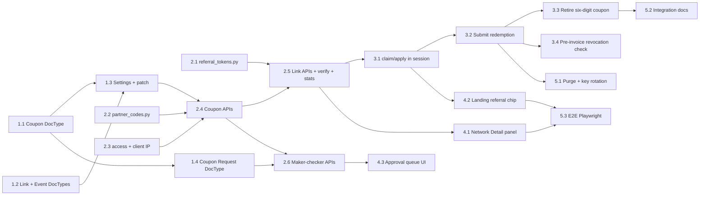

> **⚠ SUPERSEDED, DO NOT USE.** This feature was implemented elsewhere. See `../DO-NOT-USE.md`. AI agents and BMAD skills must not reference this file in future work or enhancements.

# Epics and stories

## Dependency graph (Rule 10)



Stories with no incoming arrows start first: 1.1, 1.2, 2.1, 2.2, 2.3.

All Python stories: run `bench restart` after the change. DocType stories: run `bench migrate`.
Tests use the scratch runner from the bench environment notes
(`python run_tests.py <test site> <module>`).

---

## Epic 1: Schema

### Story 1.1: `CRM Partner Coupon` DocType · S
- **Primary:** `crm/fcrm/doctype/crm_partner_coupon/crm_partner_coupon.json`
- **Create:** that JSON, `crm_partner_coupon.py`, `test_crm_partner_coupon.py`
- **Depends on:** None. **Blocks:** 1.3, 2.4
- **Spec:** fields per architecture §3.1. The controller `validate()` normalises `code`, enforces
  the Vanity rules (cap + expiry, 8–20 chars, not all digits, `approved_request` required) and makes `external_ref` unique
  per network. Permissions: System Manager and Sales Manager full; Network Coordinator read
  (scoped by `has_permission` in 2.3).
- **AC:** `bench --site <site> migrate` exits 0. The test module passes and covers "vanity
  without expiry → ValidationError" and "duplicate code → DuplicateEntryError".

### Story 1.2: `CRM Referral Link` + `CRM Referral Event` + `CRM Partner Share Host` · M
- **Primary:** `crm/fcrm/doctype/crm_referral_link/crm_referral_link.json`
- **Create:** `crm_referral_link/{json,py,test}`, `crm_referral_event/{json,py}`,
  `crm_partner_share_host/{json}` (child table, `istable: 1`)
- **Modify:** `crm/fcrm/doctype/crm_opt_in_network/crm_opt_in_network.json` (add the
  `share_hosts` table)
- **Depends on:** None. **Blocks:** 1.3, 2.5
- **Spec:** §3.2–3.4. `CRM Referral Event` sets `in_create: 1` and has no write permission
  except for System Manager. The share host validator lowercases the value and rejects a
  scheme, path, port or wildcard.
- **AC:** migrate exits 0. The test asserts that `share_hosts` rejects `https://x.example.test/a`.

### Story 1.3: Settings section + setup patch · S
- **Primary:** `crm/patches/v1_0/referral_links_setup.py`
- **Modify:** `crm/fcrm/doctype/crm_opt_in_settings/crm_opt_in_settings.json`, `crm/patches.txt`
- **Depends on:** 1.1, 1.2. **Blocks:** 2.4
- **Spec:** §3.5 settings plus the §3.6 custom fields on `CRM Facility Membership`. The patch
  generates `referral_signing_key` (`secrets.token_bytes(32)`, base64) with a `kid` (8 hex) and
  `referral_privacy_pepper`. It is idempotent and never overwrites existing keys.
- **AC:** running `bench --site <site> execute crm.patches.v1_0.referral_links_setup.execute`
  twice leaves `referral_signing_kid` unchanged on the second run.

### Story 1.4: `CRM Partner Coupon Request` DocType · S
- **Primary:** `crm/fcrm/doctype/crm_partner_coupon_request/crm_partner_coupon_request.json`
- **Create:** that JSON, `crm_partner_coupon_request.py`, `test_crm_partner_coupon_request.py`
- **Depends on:** 1.1. **Blocks:** 2.6
- **Spec:** architecture §3.7. The controller makes decided requests immutable, requires a note
  on Reject, and enforces `decided_by != requested_by_user`.
- **AC:** the test asserts that the requesting user deciding their own request →
  PermissionError, and that editing an Approved request → ValidationError.

---

## Epic 2: Backend core

### Story 2.1: Pure token sign and verify · S
- **Primary:** `crm/utils/referral_tokens.py`
- **Create:** that module, `crm/tests/test_referral_tokens.py`
- **Depends on:** None. **Blocks:** 2.5
- **Signature (Rule 8):**
  ```python
  @dataclass(frozen=True)
  class ParsedToken: kid: str; link_id: str; exp: int; sig: str
  def sign(key: bytes, kid: str, link_id: str, exp: int, partner_id: str) -> str
  def parse(token: str) -> ParsedToken | None          # length cap 200, strict charset
  def verify(parsed: ParsedToken, key: bytes, partner_id: str, now: int) -> bool  # compare_digest
  ```
- **Spec:** §4.1. No Frappe imports. `exp` is base36 in the token.
- **AC:** the test module passes and covers round-trip, every field mutated, a truncated sig,
  an expired token, an over-long token and a non-ASCII token.

### Story 2.2: Coupon code generation and normalisation · S
- **Primary:** `crm/utils/partner_codes.py`
- **Create:** that module, `crm/tests/test_partner_codes.py`
- **Depends on:** None. **Blocks:** 2.4
- **Signature:**
  ```python
  def generate_code() -> str                      # 12 Crockford chars + check
  def normalise(raw: str) -> str | None           # None on bad charset or check char
  def display(code: str) -> str                   # XXXX-XXXX-XXXX-C
  def is_valid_vanity(raw: str) -> bool           # 8–20 [A-Z0-9], not all digits
  ```
- **AC:** tests pass. `normalise(display(generate_code()).lower().replace("0","O"))` round-trips,
  and a check-character flip returns None.

### Story 2.3: Scoped partner access + trusted client IP · M
- **Primary:** `crm/partner_portal/access.py`
- **Create:** that module, `crm/tests/test_partner_access.py`
- **Modify:** `crm/api/facility_onboarding.py` (`_client_ip` delegates to the new helper)
- **Depends on:** None. **Blocks:** 2.4, 3.1
- **Signature:**
  ```python
  def assert_network_scope(network: str, *, write: bool = True) -> None   # raises PermissionError
  def client_ip() -> str   # right-most non-trusted hop of X-Forwarded-For; trusted_proxies CIDRs from site config
  ```
- **Spec:** §7. No Guest path and no "no network yet" bypass. Read scope allows a Network
  Coordinator of that network. `_assert_portal_access` is **not** changed here (that would be
  a separate fix for the existing endpoints, so it goes on the follow-up list).
- **AC:** the test asserts Guest → PermissionError, an unlisted coordinator → PermissionError,
  and `X-Forwarded-For: 1.1.1.1, <proxy>` resolves to `1.1.1.1` only when the proxy is trusted.

### Story 2.4: Coupon APIs · M
- **Primary:** `crm/partner_portal/referrals.py`
- **Create:** that module (coupon half), `crm/tests/test_partner_referral_api.py`
- **Modify:** `crm/api/partner_portal.py` (re-export, matching the existing alias pattern)
- **Depends on:** 1.1, 1.3, 2.2, 2.3. **Blocks:** 2.5
- **Signature:** `create_partner_coupon`, `list_partner_coupons`, `revoke_partner_coupon` per §8.
  `@frappe.whitelist(methods=[...])`, idempotency via `crm.partner_portal.utils.check_idempotency`.
- **Context7 (Rule 11):** re-check `frappe.whitelist(methods=)` and `frappe.get_list`
  pagination for the installed version before coding.
- **Spec note:** random codes only. Custom codes go through 2.6.
- **AC:** POST `create_partner_coupon` as Guest → 403. Repeating the same idempotency key
  returns `cached: true` with the same `code`. Revoking twice returns the same `revoked_at`.

### Story 2.5: Referral link APIs, verify and stats · L
- **Primary:** `crm/partner_portal/referrals.py` (link half)
- **Modify:** `crm/tests/test_partner_referral_api.py`
- **Depends on:** 1.2, 2.1, 2.4. **Blocks:** 3.1, 4.1
- **Signature:** `create_referral_link`, `list_referral_links`, `revoke_referral_link`,
  `reissue_referral_link`, `verify_referral`, `get_referral_stats` per §8. Internal helper
  `resolve_token(token) -> tuple[doc | None, reason]` is shared with 3.1.
- **Spec:** `share_url` only for an exact-match enabled share host. `expires_at` is capped at
  `referral_link_max_days`. Stats return aggregates only.
- **AC:** the test asserts an unregistered `share_host` → 422; `verify_referral` on a token
  with a flipped sig character → `{valid: false, reason: "invalid"}`; on a revoked link →
  `{valid: false, reason: "revoked"}`.

### Story 2.6: Maker-checker custom coupon APIs · M
- **Primary:** `crm/partner_portal/coupon_requests.py`
- **Create:** that module, `crm/tests/test_coupon_requests.py`
- **Modify:** `crm/api/partner_portal.py` (re-export)
- **Depends on:** 1.4, 2.4. **Blocks:** 4.3
- **Signature:** `request_custom_coupon`, `get_coupon_request`, `list_coupon_requests`,
  `withdraw_coupon_request`, `decide_coupon_request(name, decision, note)` per architecture §8.
  `decide_coupon_request` requires Sales Manager or System Manager, never a Partner Portal API
  user. On a new request, notify Sales Managers (`frappe.publish_realtime` + a CRM Notification).
- **AC:** the test asserts that the API user deciding → 403; the maker deciding their own
  request → 403; approving a code taken meanwhile → 409 and the request stays Pending; Approve
  creates exactly one Vanity coupon.

---

## Epic 3: Redemption in Value Express

### Story 3.1: `claim_referral` / `apply_coupon` / `remove_referral` on the session · M
- **Primary:** `crm/api/facility_onboarding.py`
- **Modify:** `crm/tests/test_facility_onboarding_session.py`
- **Depends on:** 2.3, 2.5. **Blocks:** 3.2, 4.2
- **Spec:** §6 and §8 guest table. `@frappe.whitelist(allow_guest=True, methods=["POST"])` +
  `@rate_limit(limit=10, seconds=600, ip_based=True)` (installed Frappe v15.107.5 signature,
  research R19). Errors per D6. The claim is stored in the session, `locked` is set in
  `verify_otp`, and a claim on a locked session needs `confirm_switch=1`. Events are written
  with deduplication.
- **AC:** the test asserts the 11th claim within 10 min → 429; a tampered token returns the
  generic message; a locked session without `confirm_switch` keeps the first network.

### Story 3.2: Server-side redemption at submit · M
- **Primary:** `crm/api/facility_onboarding.py` (`submit_onboarding`, `_upsert_facility_membership`)
- **Modify:** `crm/tests/test_journey_separation.py`, `crm/tests/test_express_draft_order.py`
- **Depends on:** 3.1. **Blocks:** 3.3, 5.1
- **Spec:** a session claim overrides the client `partner_id`. Re-verify under `for_update`,
  increment the counters, and write `partner_coupon_ref`, `referral_link` and
  `attribution_source` on the customer-linked row only. A revoked or exhausted claim submits
  without the bonus and returns `coupon_dropped: true`.
- **AC:** the tests assert two concurrent submits on a `max_redemptions=1` coupon → exactly
  one membership row with `partner_coupon=1`; an Opt-In row in the same network is untouched;
  `eligible_bonuses` includes Partner Coupon for the converted facility.

### Story 3.3: Retire the six-digit Partner ID coupon · S
- **Primary:** `crm/api/facility_onboarding.py` (`get_catalog`, `submit_onboarding`, `check_onboarding_conflicts`)
- **Modify:** `crm/tests/test_facility_onboarding_session.py`
- **Depends on:** 3.2. **Blocks:** 5.2
- **Spec:** the client-sent `partner_id` no longer grants `partner_coupon`. Only a session
  claim (link or coupon code) does. `facility_onboarding_default_partner_id` keeps working for
  the default network, with no bonus.
- **AC:** the test asserts `submit_onboarding(partner_id="<6 digits>")` without a claim →
  membership row with `partner_coupon = 0`.

### Story 3.4: Pre-invoice revocation check + replace coupon · M
- **Primary:** `crm/utils/token_bonus.py` (`_coupon_network`)
- **Modify:** `crm/api/customer_experience.py` (new `replace_partner_coupon`, and a
  `coupon_withdrawn` notice in the order/checkout payload), `crm/tests/test_express_draft_order.py`
- **Depends on:** 3.2. **Blocks:** 5.3
- **Spec:** architecture §6 (Q1). The bonus applies only while the row's `partner_coupon_ref`
  coupon and its `referral_link` (if any) are Active. Confirmed orders are never touched.
  `replace_partner_coupon` accepts only a coupon from the same network, and only before
  the order is confirmed.
- **AC:** the test revokes the coupon after a draft order is created → `apply_bonus_lines`
  returns no Partner Coupon line and the payload has `coupon_withdrawn: true`; a confirmed
  order's lines are unchanged.

---

## Epic 4: Frontend

### Story 4.1: Network Detail "Coupons & referral links" panel · L
- **Primary:** `frontend/src/pages/Networks/NetworkReferralsPanel.vue`
- **Create:** that component, `frontend/src/utils/referralFormat.js`,
  `frontend/tests/unit/referralFormat.test.js`
- **Modify:** `frontend/src/pages/Networks/NetworkDetail.vue` (mount the panel, retire the
  single Partner Coupon card)
- **Depends on:** 2.5. **Blocks:** 5.3
- **Interface (Rule 9):**
  ```js
  // props: { network: String, partnerId: String, canManage: Boolean }
  const coupons = createResource({ url: 'crm.partner_portal.referrals.list_partner_coupons', params: { partner_id } })
  const links   = createResource({ url: 'crm.partner_portal.referrals.list_referral_links',  params: { partner_id } })
  // create via formDialog(); revoke via $dialog confirm with required reason
  ```
- **Context7 (Rule 11):** frappe-ui `createResource`, `ListView`/`Badge`, Vue 3 `defineProps`.
- **AC:** `yarn test:run` passes, with `referralFormat` covering status badge, cap display and
  expiry text. `yarn build` exits 0.

### Story 4.2: Landing referral claim and chip · M
- **Primary:** `frontend/src/pages/FacilityOnboarding/FacilityOnboardingLanding.vue`
- **Modify:** `frontend/src/utils/valueExpress.js` (read `ref`, keep in `sessionStorage`,
  `replaceState`), `frontend/tests/unit/valueExpress.test.js`
- **Depends on:** 3.1. **Blocks:** 5.3
- **Spec:** §10 landing. Branding only from the `claim_referral` response. Switch prompt when
  locked. `?partner_coupon=` / `?partner_id=` are ignored (legacy retired). Sets the
  `Referrer-Policy: no-referrer` meta on this route.
- **AC:** the unit test asserts `ref` is removed from the URL after parsing, and that
  `partner_coupon=123456` no longer pre-fills a coupon. `yarn build` exits 0.

### Story 4.3: Coupon request approval queue · M
- **Primary:** `frontend/src/pages/Networks/CouponRequests.vue`
- **Modify:** `frontend/src/router.js` (route), `frontend/src/pages/Networks/NetworkDetail.vue`
  (pending badge + "Request custom code" for staff makers)
- **Depends on:** 2.6. **Blocks:** 5.3
- **Interface:**
  ```js
  const requests = createResource({ url: 'crm.partner_portal.coupon_requests.list_coupon_requests', params: { status: 'Pending' } })
  const decide = createResource({ url: 'crm.partner_portal.coupon_requests.decide_coupon_request' })
  // Approve disabled when request.requested_by_user === session user; Reject needs a note
  ```
- **AC:** `yarn build` exits 0. The E2E in 5.3 covers approve and reject.

---

## Epic 5: Operations, docs, E2E

### Story 5.1: Retention purge + key rotation commands · S
- **Primary:** `crm/utils/referral_maintenance.py`
- **Modify:** `crm/hooks.py` (`scheduler_events.daily`)
- **Depends on:** 3.2. **Blocks:** None
- **Signature:** `purge_referral_events()`, `expire_referrals()`,
  `rotate_referral_key()`, `retire_previous_referral_key()` (System Manager, whitelisted).
- **AC:** `bench --site <site> execute crm.utils.referral_maintenance.purge_referral_events`
  exits 0 and removes a seeded 91-day-old `claimed` event, but keeps a `converted` one.

### Story 5.2: Partner Portal integration guide · S
- **Primary:** `docs/partner-portal-referral-apis.md`
- **Modify:** `docs/optin-and-partner-coupon-journeys.md` (add referral links to the table)
- **Depends on:** 3.3. **Blocks:** None
- **Spec:** endpoints, examples with placeholder hosts, the portal 302 rule, the
  `verify_referral` resolution requirement, the error envelope, and key rotation behaviour.
  No real URLs, emails or facility identifiers.
- **AC:** `grep -nE "https?://[a-z0-9.-]+\.(com|ke|org)" docs/partner-portal-referral-apis.md`
  returns nothing.

### Story 5.3: Live journey E2E · M
- **Primary:** `e2e/referral-links/referral.spec.ts`
- **Create:** that spec, `e2e/referral-links/playwright.config.ts`,
  `crm/tests/e2e_referral_fixture.py`
- **Depends on:** 4.1, 4.2. **Blocks:** None
- **Spec:** synthetic network → API create link → open the canonical URL → chip shown →
  onboard → membership row with `referral_link` → revoke → a second visitor sees "withdrawn"
  and can still onboard without the bonus → a draft order created before the revoke shows the
  "withdrawn" notice at checkout → a portal custom-code request is approved by a second staff
  user. Teardown leaves 0 synthetic records.
- **AC:** `BASE_URL=<site url> SITE=<site> npx playwright test --config
  e2e/referral-links/playwright.config.ts` reports all passing.

---

## Follow-ups (not in these stories)

- Close the Guest path in `_assert_portal_access` for the existing `deal_won` /
  `configure_facility_pricing` endpoints (C2). It is a behaviour change for current portal
  callers, so coordinate it with the portal team.
- Conversion and coupon-request decision webhooks to the Partner Portal (Q3, phase 2).
- QR code rendering on Network Detail and the portal.
