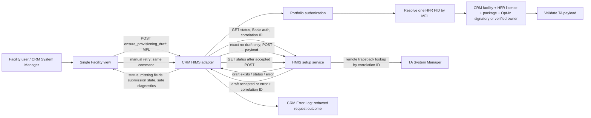

# HIMS implementation PRD

**Status:** Implementation baseline 1.0
**Owner:** CRM / Customer Experience
**Systems:** CRM (`crm`), CX Portal, HFR, HMIS setup service (`hmis_setup`)
**Upstream contract:** [`EXTERNAL_PROVISIONING_API (1).md`](../../EXTERNAL_PROVISIONING_API%20(1).md)

## 1. Problem and outcome

The Single Facility view could report that no setup draft existed without creating one reliably. The read call also attempted a write, a previous ambiguous POST could leave a sticky cache state, FID data could be lost between facility records, and a generic service error gave the operator no useful diagnostic context.

The required outcome is deterministic: when an authorized facility has a verified HFR FID and the setup service authoritatively reports no draft, CRM validates the server-owned facility payload, calls the TA POST, and reloads status. The page shows either the created draft, the exact data that blocks submission, or a support diagnostic with correlation ID. Creating a draft does not deploy the facility; deployment remains a human action in the setup tool.

## 2. Product rules

1. **One deployment identity:** `hfr_facility_id` (HFR Facility ID / FID) is the setup service key. MFL code locates the CRM facility; generic HIE IDs are never substituted for FID.
2. **Read and command are distinct:** `get_provisioning_status` is read-only. `ensure_provisioning_draft` is the command used by the Single Facility view on load and on retry.
3. **Only an authoritative absence creates:** CRM POSTs only after the TA GET has returned the exact documented no-setup condition (TA 400 or Frappe 417 `No Facility Setup found`). Auth, timeout, unknown errors, duplicate records, and other failures never trigger POST.
4. **No extra commercial gate:** a verified, authorized FID with no setup draft proceeds to payload validation. Deal Won and paid invoice are not prerequisites for creating the TA draft.
5. **Payload provenance:** license/registration and facility details come from CRM’s HFR-linked facility record; onboarding stores the HFR licence/registration number, and when it is blank CRM fetches it from the HFR registry by FID and stores it before building the payload. Tokens come from the facility’s selected CRM token package and default to `0` if no quantity is selected. Administrator name, email and phone come from one processed Opt-In facility signatory that matches the facility MFL or, for a self-onboarded facility (which has no Opt-In), from its one OTP-verified owner contact on the customer’s facility membership (stakeholder answer Q-SEC-2: the verified owner is the default administrator). CRM never invents contact details.
6. **Expiry:** `token_expiry_date` is the facility onboarding date plus 30 calendar days. CRM has no dedicated onboarding-date field today, so it uses the linked facility row’s CRM creation date. For a lead with no persisted facility row, the first ensure request is the onboarding start date. This policy is deterministic and surfaced in this document.
7. **Validation is actionable:** CRM validates required TA fields and types before POST. If verified contact/license data is absent or ambiguous, it returns the precise missing field list and does not send a malformed request.
8. **Draft is not deployment:** a successful POST creates a TA draft only. CRM never calls the deploy action.
9. **Retry after ambiguity:** CRM serializes per FID and rechecks TA status immediately before every POST. If a POST times out or returns 5xx, the next explicit ensure request first checks status. If TA still definitively says no draft, CRM retries POST. The TA API has no idempotency key and does not deduplicate; therefore true exactly-once semantics cannot be guaranteed across a lost response. The FID lock prevents concurrent CRM submissions, and GET reconciliation is the available duplicate control.
10. **Visible failure evidence:** each outbound request carries a correlation ID. CRM Error Log stores bounded, redacted responses. System Managers can view available TA `error` and `log` fields. A generic TA 500 response cannot reveal the remote traceback; the correlation ID must be searched in the TA site Error Log.

## 3. Architecture



### Ensure sequence

```mermaid
sequenceDiagram
  actor User
  participant UI as Single Facility view
  participant CRM as CRM HIMS adapter
  participant TA as HMIS setup service
  User->>UI: Open facility or retry
  UI->>CRM: POST ensure_provisioning_draft(MFL)
  CRM->>CRM: Authorize portfolio access; resolve verified FID
  CRM->>TA: GET get_provision_status(FID)
  alt Draft/status already exists
    TA-->>CRM: Current status
    CRM-->>UI: Current status; no POST
  else Exact no-draft response
    TA-->>CRM: not_submitted (400/417 documented condition)
    CRM->>CRM: Build and validate server-owned payload
    alt Required source data missing
      CRM-->>UI: Blocked + exact field names
    else Payload complete
      CRM->>TA: POST provision_facility(payload, correlation ID)
      alt Accepted
        TA-->>CRM: Draft accepted
        CRM->>TA: GET status again
        TA-->>CRM: Reloaded status
        CRM-->>UI: Draft/status + submission receipt
      else Timeout / 5xx / rejection
        TA-->>CRM: Error + correlation ID, or no response
        CRM-->>UI: Retryable state or actionable rejection + diagnostics
      end
    end
  else Auth / unknown / duplicate / unavailable
    TA-->>CRM: Non-absence result
    CRM-->>UI: Error/status; no POST
  end
```

## 4. API contract inside CRM

| Method | CRM RPC | Behavior |
|---|---|---|
| GET | `crm.api.hfr.get_provisioning_status(mfl_code)` | Read status only. Never POSTs. |
| POST | `crm.api.hfr.ensure_provisioning_draft(mfl_code)` | Resolve access and FID, GET TA status, POST only on exact no-draft, then reload. |

TA endpoints are `GET /api/method/hmis_setup.api.external_provisioning.get_provision_status?fid={FID}` and `POST /api/method/hmis_setup.api.external_provisioning.provision_facility` using the configured service user’s Basic API-key authentication. Credentials remain server-side.

## 5. Stories and acceptance criteria

### HIMS-01 — Resolve canonical facility identity (implemented)

- Given an authorized MFL, CRM resolves exactly one linked facility and its HFR FID.
- FID fallback across Pre-Qualified Facility, Deal Facility, Lead Facility and the HFR registry is deterministic; conflicting registry FIDs do not select an arbitrary record.
- A missing FID returns `not_linked`; no TA request is made.

### HIMS-02 — Separate status query from draft creation (implemented)

- GET status is side-effect free and restricted to GET.
- Ensure is a separate POST command and is the Single Facility view’s initial-load and retry action.
- Existing draft statuses are returned without calling TA POST.

### HIMS-03 — Create on authoritative absence (implemented)

- TA’s documented no-setup response is normalized to `not_submitted`.
- On `not_submitted`, CRM builds and validates the payload, then calls TA POST.
- CRM refreshes status after accepted POST and reports the returned setup reference where available.
- No Won-deal or paid-invoice gate can silently suppress the POST.

### HIMS-04 — Deterministic payload and expiry (implemented baseline)

- Required TA field names and types are validated before network submission.
- Token billing model is used for CRM token packages; absent token quantity maps to `0` (accepted by TA).
- `token_expiry_date` equals CRM facility onboarding date plus 30 calendar days, using the date source in §2.
- Only one unambiguous processed Opt-In signatory matching the MFL supplies admin contact values. Without one, a self-onboarded facility uses its one OTP-verified owner contact for the signed-in customer. Missing or conflicting values block the POST and list fields.
- A blank licence is fetched from the HFR registry by FID and stored on the CRM facility rows. If HFR integration is off or the lookup fails, `licence` stays missing and the failure is logged for support, not shown to the customer.

### HIMS-05 — Serialize, reconcile, and retry (implemented baseline)

- Concurrent ensure requests for a FID serialize under a per-FID lock and each rechecks upstream status before POST.
- A failed/ambiguous attempt does not become a permanent cache veto. A later ensure GETs first and retries only if TA again confirms no draft.
- A definitive 4xx rejection for the same payload is not blindly repeated; changing source data changes the request fingerprint and permits a fresh attempt.
- Duplicate/ambiguous TA setup records stop automatic submission and surface support review.

### HIMS-06 — Make errors diagnosable (implemented baseline)

- Every TA request carries a correlation ID; CRM records the ID and HTTP status with bounded redacted response data.
- Facility users get a concise error and safe retry state. System Managers can inspect redacted service response and TA `log`/`error` fields returned by status.
- The UI explicitly says when the remote service supplied only a generic 500, so no traceback exists in CRM to display; it presents the correlation ID for TA-side lookup.
- Secrets and credentials never appear in browser responses or logs.

### HIMS-07 — Make the Single Facility view usable (implemented baseline)

- FID appears as the canonical deployment identity, including when resolved by the backend.
- Status, draft submission state, blockers, retry action, HTTP status and correlation ID are visibly distinct.
- Retry uses the ensure command; it does not call GET and leave a no-draft facility unchanged.
- Diagnostics use a readable dialog with selectable raw bounded response text, not a full-page dim layer that obscures the context.

### HIMS-08 — Protect the contract with regression coverage (in progress)

- Backend tests cover read/command separation, status normalization, exact payload, expiry policy, errors, redaction, retry and FID lock behavior.
- Playwright covers missing-FID resolution, no-draft creation state, retry and diagnostics dialog.
- Deployment verification records the environment, endpoint, status codes and correlation IDs; secrets and real patient data are excluded.

## 6. Operational requirements

- External setup URL must use HTTPS; service credentials are configured in `CRM HFR Settings` and never returned to ordinary portal users.
- A status refresh must not create a setup draft. Only the ensure command has write behavior.
- The setup service’s lack of idempotency/deduplication is a known integration limitation. TA-side idempotency by FID is the follow-up needed for mathematically safe retries after lost POST responses.
- Creating a draft has no deployment, billing, or user-account side effect in CRM.

## 7. Verification state

The implementation is being verified against CRM unit coverage and the Single Facility Playwright regression. A synthetic authenticated TA GET previously confirmed that “No Facility Setup found” can arrive as HTTP 417 from Frappe; the adapter maps this exact response to `not_submitted`. Do not use a real facility POST as a probe: POST creates persistent TA state. A real POST should be verified only when an explicitly selected facility is confirmed to have no draft and its CRM payload is complete.

## 8. Superseded document

[`facility-auto-provisioning-prd.md`](facility-auto-provisioning-prd.md) is retained as historical context and superseded by this PRD. Its earlier Won-deal/paid-invoice trigger and unresolved expiry assumptions are no longer current.
