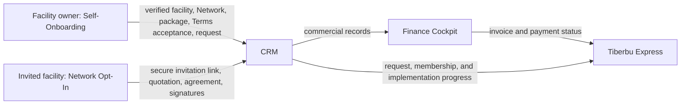

# Tiberbu Solution Guides

This guide set explains the user workflows and operating handoffs across four connected workspaces. Each guide is standalone and has a user walkthrough plus stakeholder and operations instructions.

## How work moves between solutions

Self-Onboarding and Network Opt-In are separate routes. Self-Onboarding is the
primary public journey: it records acceptance of its Terms and submits a
request, with no signature, signatory, witness, or contract-signing step.
Network Opt-In is invitation-only; its secure email link opens the separate
quotation, agreement, and signature process for a facility already added to a
Network. CRM manages both route records and the Network relationship; Finance
records invoice and payment outcomes; Tiberbu Express shows the facility
owner's permitted journey status. A selected token package is a commercial
selection. It is not, by itself, a payment, a remaining-token balance, or
proof that an HMIS site is live.

## Open a guide

1. [Facility self-onboarding and token selection](facility-self-onboarding.md) — public identity verification, HFR facility selection, Network confirmation, token package choice, Terms acceptance, and request submission without signatures.
2. [CRM](crm.md) — facility, Network, Opt-In, signature, and commercial handoffs for CRM staff.
3. [Finance Cockpit](finance-cockpit.md) — receivables, invoices, payment allocation, and signed-facility accounting handoffs.
4. [Tiberbu Express (CX Portal)](cx-portal.md) — facility owners' portfolio, single-facility view, bills, payment status, Go Live token alignment, and implementation status.

## Download the PDFs

- [Solution handoff overview](pdf/tiberbu-solution-handoff-overview.pdf)
- [Facility self-onboarding guide](pdf/facility-self-onboarding-guide.pdf)
- [CRM user guide](pdf/crm-user-guide.pdf)
- [Finance Cockpit guide](pdf/finance-cockpit-guide.pdf)
- [Tiberbu Express guide](pdf/customer-experience-guide.pdf)

## Who uses each guide

| Audience | Start with |
|---|---|
| Facility owners | Choose public Self-Onboarding or use the secure link for an invited Network Opt-In; then Tiberbu Express |
| CRM and onboarding staff | Support Self-Onboarding requests and process the separate invitation-only Network Opt-In |
| Accounts staff | Finance Cockpit |
| Network and implementation support | CRM and Tiberbu Express |
| Product and operations leads | Handoff overview, then the relevant workspace guide |

## Screenshots and example data

Screenshots of the onboarding, Tiberbu Express, and Finance Cockpit frontends use synthetic demonstration records. Sample names, identifiers, and prices are illustrative. Do not use the screenshot values to make a payment or create a real facility record.
