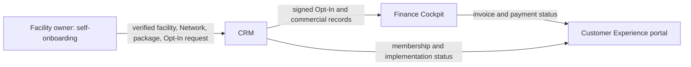

# Tiberbu Solution Guides

This guide set explains the user workflows and operating handoffs across four connected workspaces. Each guide is standalone and has a user walkthrough plus stakeholder and operations instructions.

## How work moves between solutions

Facility and Network information travels with the Opt-In request so the same details do not need to be re-entered. CRM manages the Network relationship and Opt-In process; Finance records invoice and payment outcomes; Customer Experience shows the facility owner's permitted view of the journey. A selected token package is a commercial selection. It is not, by itself, a payment, a remaining-token balance, or proof that an HMIS site is live.

## Open a guide

1. [Facility self-onboarding and token selection](facility-self-onboarding.md) — identity verification, HFR facility selection, Network confirmation, token package choice, review, and submission.
2. [CRM](crm.md) — facility, Network, Opt-In, signature, and commercial handoffs for CRM staff.
3. [Finance Cockpit](finance-cockpit.md) — receivables, invoices, payment allocation, and signed-facility accounting handoffs.
4. [Customer Experience (CX Portal)](cx-portal.md) — facility owners' portfolio, single-facility view, bills, payment status, Go Live token alignment, and implementation status.

## Download the PDFs

- [Solution handoff overview](pdf/tiberbu-solution-handoff-overview.pdf)
- [Facility self-onboarding guide](pdf/facility-self-onboarding-guide.pdf)
- [CRM user guide](pdf/crm-user-guide.pdf)
- [Finance Cockpit guide](pdf/finance-cockpit-guide.pdf)
- [Customer Experience guide](pdf/customer-experience-guide.pdf)

## Who uses each guide

| Audience | Start with |
|---|---|
| Facility owners | Facility self-onboarding, then Customer Experience |
| CRM and onboarding staff | Facility self-onboarding and CRM |
| Accounts staff | Finance Cockpit |
| Network and implementation support | CRM and Customer Experience |
| Product and operations leads | Handoff overview, then the relevant workspace guide |

## Screenshots and example data

Screenshots of the onboarding, Customer Experience, and Finance Cockpit frontends use synthetic demonstration records. Sample names, identifiers, and prices are illustrative. Do not use the screenshot values to make a payment or create a real facility record.
