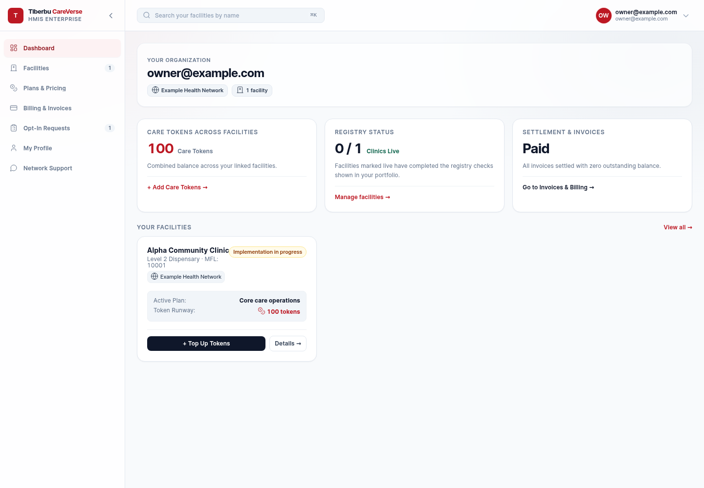
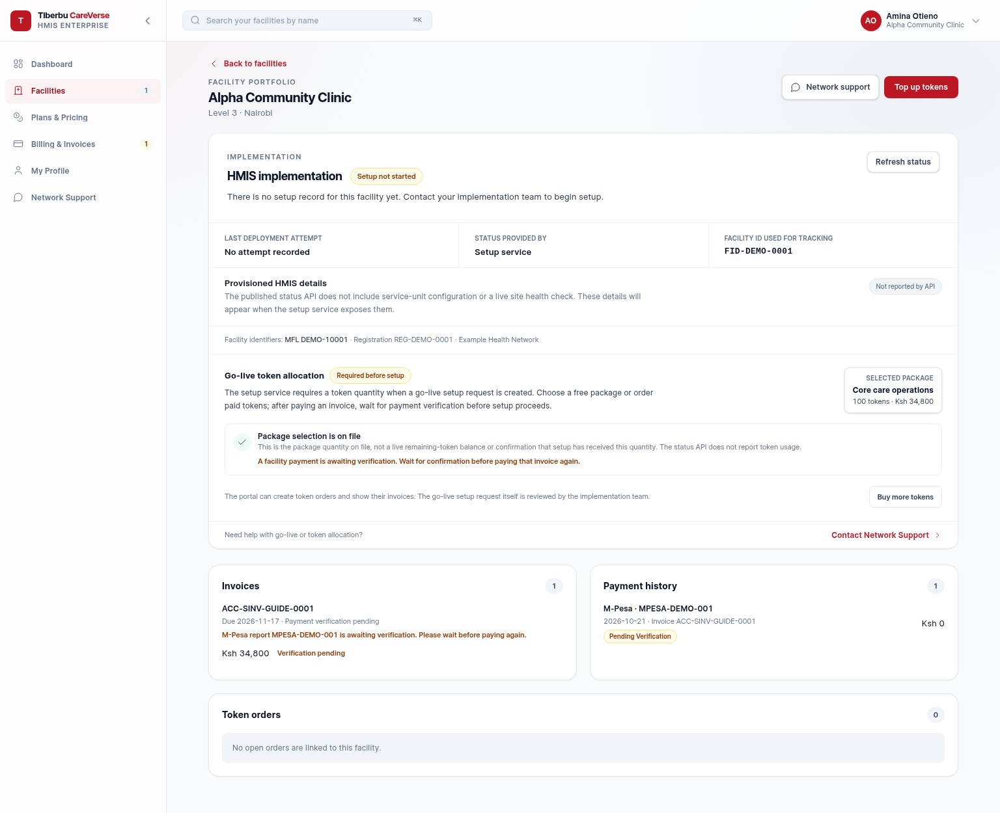

# Customer Experience (CX Portal) Guide

**Audience:** facility owners, facility office managers, and support teams\
**Start at:** `/cx-portal`\
**Your outcome:** find your facilities by name, review one facility's complete journey, understand token and Go Live readiness, and know when to contact support.

*Portfolio overview with synthetic demonstration records.*

*Single-facility view with a synthetic invoice and payment awaiting verification. Example values are not live customer records.*

## Sign in and find a facility

1. Sign in using the facility account issued to you.
2. Open **Facilities** from the left navigation.
3. Type part of the facility name in the portfolio search. This search is for facilities already linked to your account.
4. Check the facility name, level, and Network before opening it.
5. Select **Details** to open that facility's single-facility view.

Use a registry identifier such as MFL, FID, or registration number only when the page asks you to discover or reconcile a facility in the Health Facility Registry. The normal portfolio search finds a facility by name.

## Choose the right facility journey

**Self-Onboarding** is the public route for a facility owner to verify their
details, choose a Network and package, accept the Self-Onboarding Terms, and
send a request. It does not ask for a signature, signatory, or witness details;
accepting the Terms is not a signature.

**Network Opt-In** is a separate, invitation-only process for a facility that
has already been added to a Network. Open the secure link in the Network's
invitation email to review its quotation and agreement and complete any
requested signatory and signature steps. The public Opt-In entry can help you
find that route, but access is confirmed against the invitation and Network.

## Read the single-facility view

The single view puts facility identity, implementation, tokens, invoices, payments, and Network support into one page. Read it from top to bottom:

1. **Facility header:** confirm the facility name, level, Network, and registry identifiers.
2. **HMIS implementation:** check the current setup state, when it was last checked, the status source, and the latest deployment attempt.
3. **Go-live token allocation:** see the package/order connected to the facility and whether it has an invoice or payment step still in progress.
4. **Invoices:** review invoice number, due date, amount, and outstanding state.
5. **Payment history:** check whether a payment was matched to the facility's invoice and whether verification is still pending.
6. **Network Support:** open the support drawer to see the configured Network contact from your Opt-In Network. The same support details are available from any portal section.

When the page says **Not reported by API**, the connected implementation service did not provide that detail. It does not mean that the site is healthy, unhealthy, or fully configured.

## Understand tokens and Go Live together

A facility that is not yet live may need Go Live tokens before its implementation can proceed. The single-facility page connects the token selection and order to implementation status, while keeping each state visible:

| Portal item | What it means |
|---|---|
| Free token option | Selects an eligible no-charge package when one is offered. It still creates a package/order record and does not mean the facility is live. |
| Paid token option | Creates an order for a priced package. Review the invoice and complete payment through the displayed payment flow. |
| Package quantity | The quantity on the selected package/order. It is not necessarily the current remaining balance. |
| Invoice outstanding | An amount Finance has invoiced and that remains due. Pay only against the invoice shown as open. |
| Payment pending verification | A payment attempt/reference has not yet been matched or confirmed. Wait for the outcome before starting another payment. |
| Go Live status | The status reported by the implementation service. Payment or package selection alone does not update it. |

For a paid package, review the package name, token quantity, KES price, VAT, and gross amount before ordering. After payment, allow the payment verification step to finish. If the invoice is outstanding or payment is pending, use the status shown on that invoice/payment row to decide the next action; do not start another checkout just because a payment verification message is visible elsewhere.

The portal can create a token order and show its invoice. The implementation team reviews and starts the Go Live setup request. Token selection, payment verification, and site deployment are related handoffs, but they are separate statuses.

## Read the implementation status

The implementation card may show states such as **Not started**, **Draft**, **Queued**, **In progress**, **Deployed**, or **Needs implementation support** when the setup service reports them.

- Select **Refresh status** to request the latest published status.
- If the status is still loading, wait for the result before trying again.
- If the service reports an error, use the action shown on the page or open Network Support.
- If the page says no setup record exists, contact the implementation team to begin setup.
- Site health and configured service units appear only when the service provides those fields.

A deployment-status refresh does not change the invoice or payment state. Likewise, paying an invoice does not by itself prove that the HMIS site has been deployed.

## Billing and payment

Open the invoice row to check the facility, amount, due date, and outstanding amount before paying. Use the payment method presented for that specific open invoice. A payment initiated through M-Pesa or Paystack may remain pending while the provider and Finance records are reconciled.

If a payment is **Pending verification**, wait for it to resolve and refresh the page. Do not start a second payment for the same invoice unless the page explicitly says the previous attempt failed and offers a retry. If the invoice remains outstanding after you have a payment receipt, use Network Support and provide the invoice number, payment reference, amount, and time paid. Never send a PIN or one-time code to support.

## Network support drawer

Select **Network Support** in the navigation or the support control on a facility page. The drawer shows the Network's configured contact name, phone, email, and guidance wherever those values are available. Confirm which Network is shown before contacting them.

Share only the facility name, invoice or payment reference, and the relevant issue. Never send your password, one-time code, or payment PIN.

## Common situations

| What you see | What to do |
|---|---|
| Facility not found in the portfolio | Check that you signed into the correct facility account; contact support to confirm the facility was linked. |
| Wrong facility or Network | Do not pay or place an order. Contact CRM/Network support to correct the relationship. |
| No invoice after package selection | Package selection may precede invoicing under the Network schedule. Check again later or ask the Network contact. |
| Payment pending verification | Wait and refresh. Keep the payment reference; do not pay twice while the attempt is unresolved. |
| Invoice still outstanding after payment | Share the invoice and payment references with support for reconciliation. |
| Provisioning status unavailable | Your billing and facility details remain available. Retry later or contact implementation support. |
| Site units or health are not shown | The setup service has not published those details to the portal yet. Ask implementation support for the current site check. |

## Stakeholder responsibilities

The portal displays the facility owner's authorized view. CRM owns the Network relationship and Opt-In context. ERPNext Finance owns invoice balances and posted receipt allocation. The implementation service owns deployment status, site health, and service-unit details that it publishes.

A facility owner can review and initiate the actions shown in the portal. CRM, Accounts, or implementation staff resolve the corresponding source records when an exception needs internal access.

## Handoff

**CRM → Facility owner:** confirmed facility and Network relationship, permitted workflow state, token package/order state, and available implementation status.

**Facility owner → Accounts/Network:** invoice or payment reference and receipt details when a reconciliation is needed.

**Facility owner → Implementation support:** facility name and displayed setup/deployment reference when Go Live status is missing or needs review.
