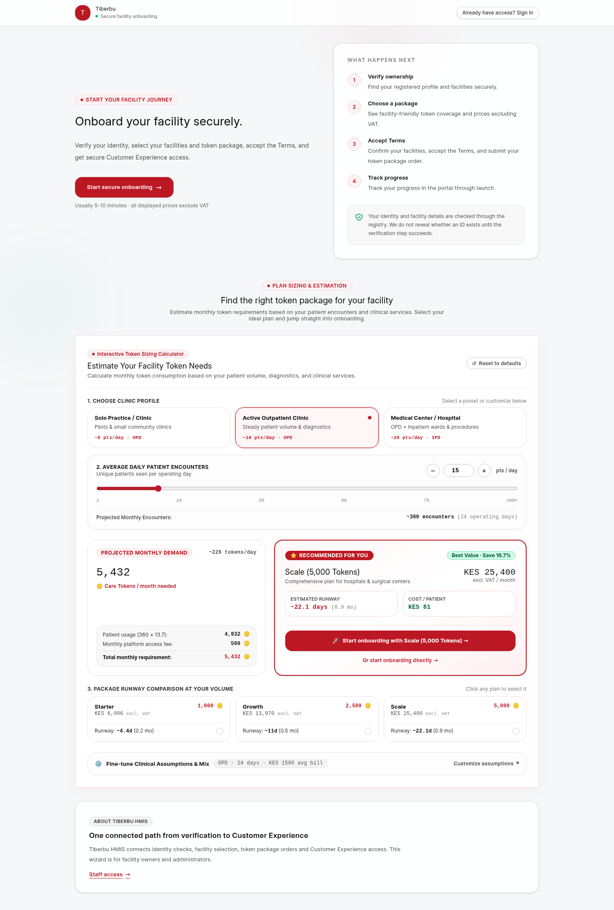
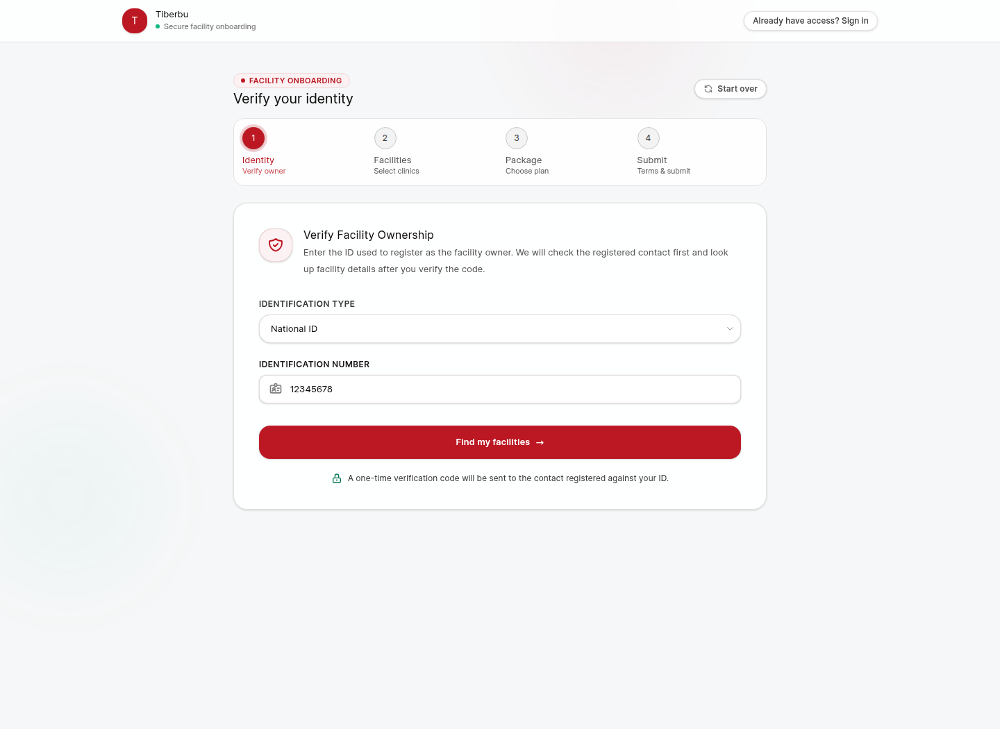
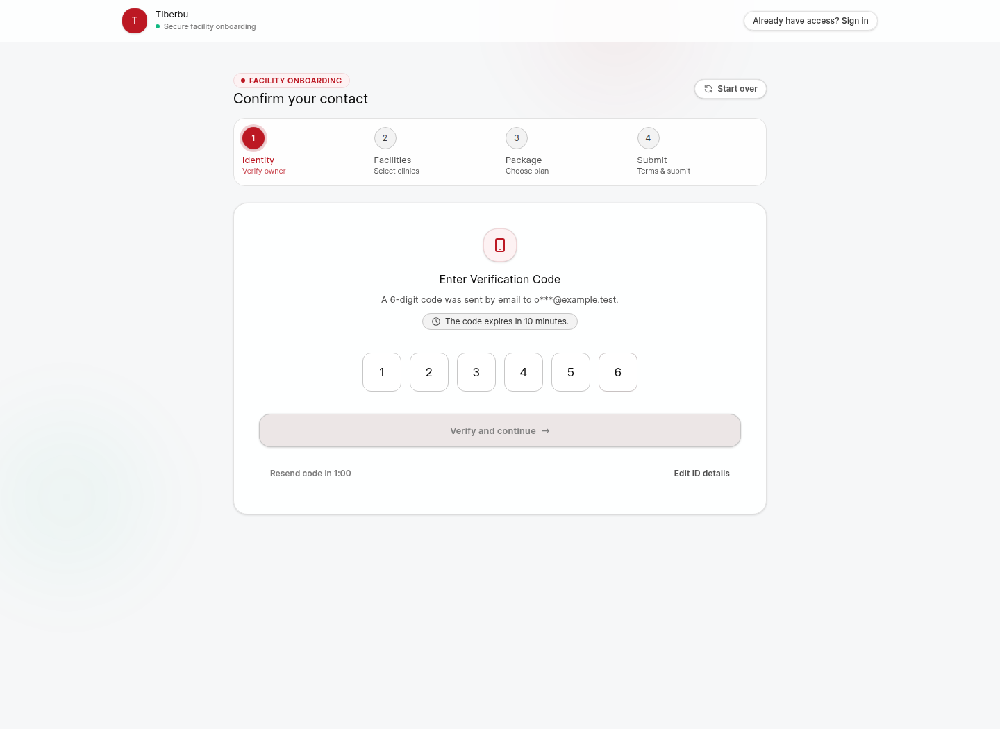
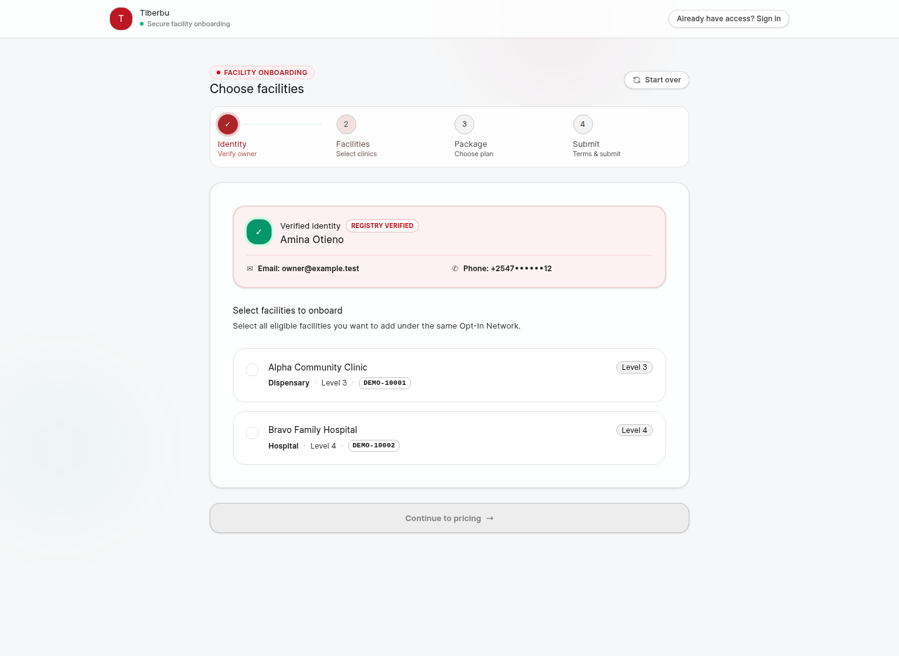
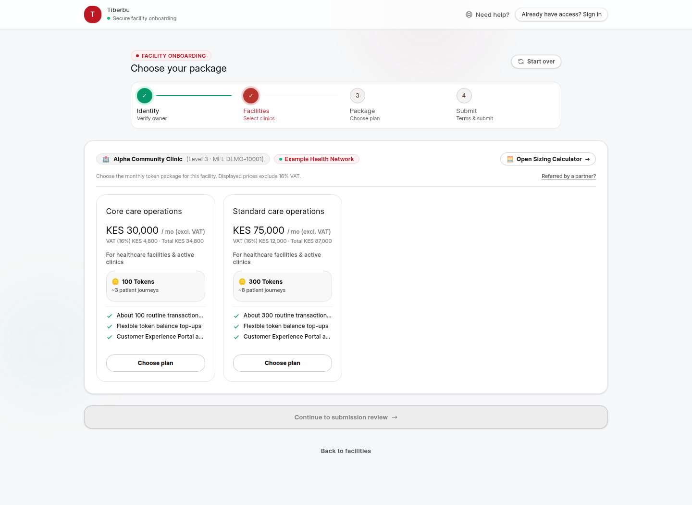
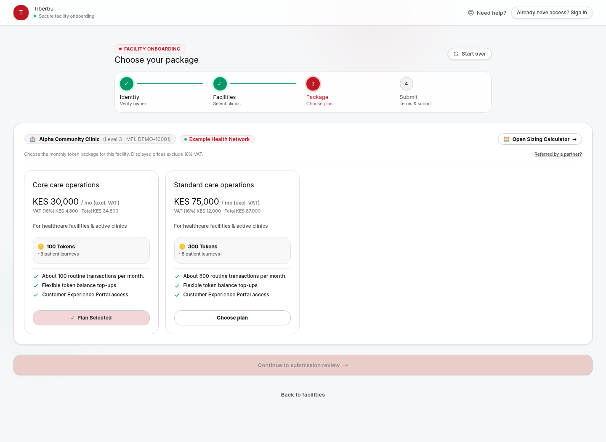
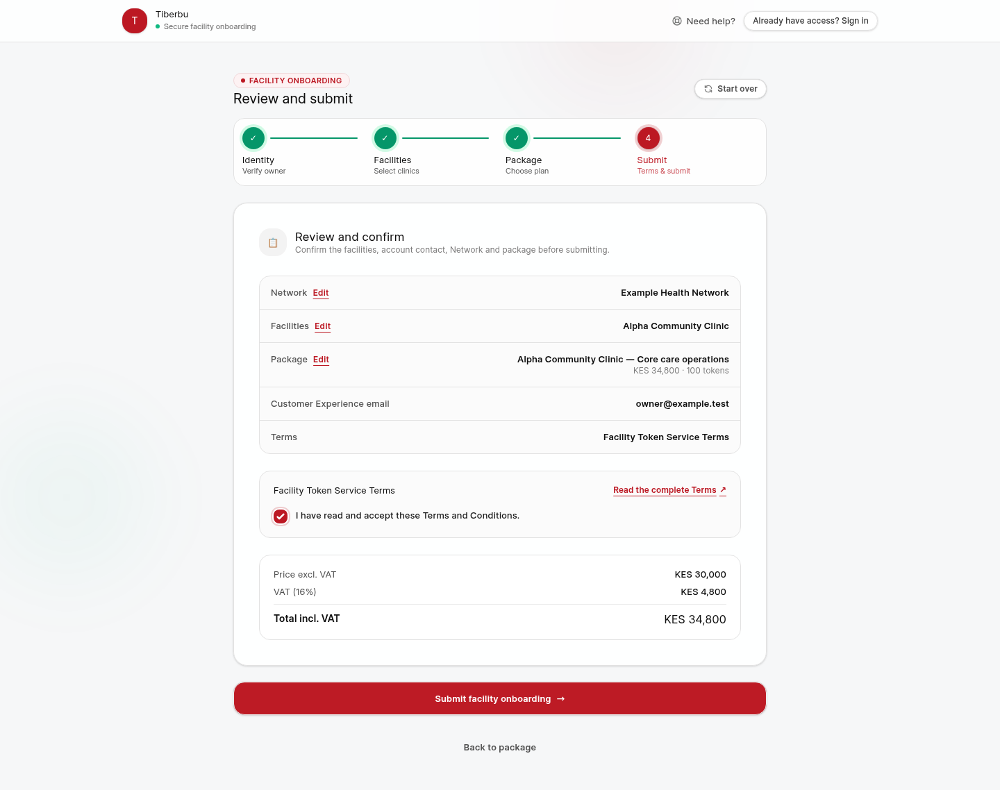
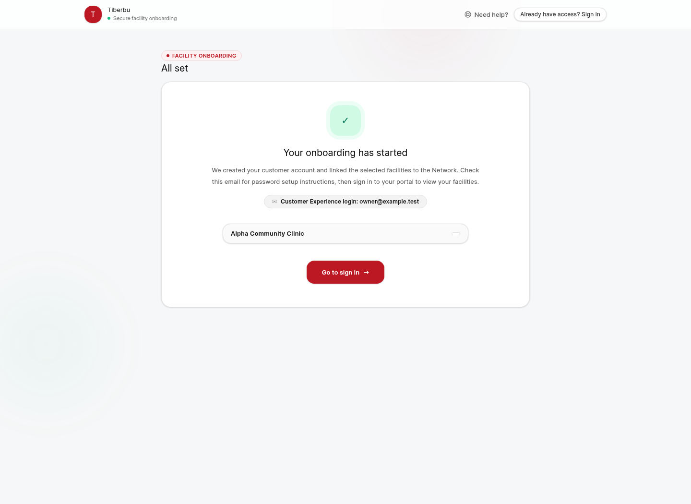

# Get Started with Facility Self-Onboarding

**For:** facility owners and administrators

**Start at:** `/facility-onboarding`

**You’ll need:** the identification linked to your facility record and access to the email address or phone number registered with it.

Self-Onboarding is a public way to verify your details, choose facilities and token packages, accept the terms, and send a request. You do not need an invitation to use it, and there is no signing step.

If your Network invited you to its separate Opt-In process, open the secure link in that invitation email. That invitation-only journey is where you review the Network quotation and agreement and provide any requested signatory details.

This guide uses **Alpha Community Clinic**, **Example Health Network**, and sample prices. The facilities and prices in the screenshots are examples, not an offer or invoice.

## The steps

1. Start Self-Onboarding and, if useful, estimate your package needs.
2. Verify your details with a one-time code.
3. Choose the eligible facilities you want to onboard.
4. Confirm the Network and select a package for each facility.
5. Review the prices and terms, then submit your request.
6. Sign in to Customer Experience to review your quote and follow the next steps.

## 1. Start and explore packages

Open the Self-Onboarding page. The optional sizing guide can help you compare packages using your estimated monthly activity. It is only an estimate; it does not set your final price or reserve tokens.

Select **Start your onboarding** when you’re ready. If you already have Customer Experience access, sign in to that account instead of starting another request.

## 2. Verify your details

Choose the identification type linked to your facility record and enter the number as requested on the page.

We’ll send a one-time code to the email address or phone number registered with your identification. Your facility details appear after you verify the code.

## 3. Check your contact

Enter all six digits and select **Verify and continue**. You can paste the code into the first box. If it has expired or was entered incorrectly, wait for the countdown and request another code. Never share a verification code with anyone.

## 4. Choose your facilities

Review each facility name, level, type, and registry number. Select the eligible facilities you want to onboard. You can choose more than one; you’ll select a package for each one on the next screen.

A facility that is already set up or is not eligible for this route cannot be selected. Registry details cannot be changed here. If a facility is missing or its details look wrong, contact support and we’ll help you find the right next step.

## 5. Confirm the Network and choose packages

If you have a six-digit Network ID, enter the ID shared by your Network contact. If you leave the field blank, the page will use the default Network when one is available. Check the Network name before you continue.

Choose a package for each selected facility. Compare its token quantity, coverage description, price before VAT, VAT, and total. These prices come from the configured package list; you cannot enter a custom price or token quantity.

1. Select **Choose plan** on the package that suits your facility.
2. If you selected more than one facility, switch between them and choose a package for each.
3. Review the package summary and combined total before you continue.

Package quantities describe the package you selected. They are not a live token balance and do not mean your facility is already live.

## 6. Review the terms and submit

Check the Network, facilities, package for each facility, verified Customer Experience email, and total. Use **Edit** if you want to change your Network, facilities, or packages.

Read the terms and select the acceptance box only when you’re ready. Self-Onboarding does not ask for signatures or witness details. The request can be submitted after the required choices and terms acceptance are complete.

Select **Submit your request** once and wait for the confirmation. If the page is slow, leave it open rather than submitting again.

## 7. Follow your next steps

Your selected facilities are linked to the Network and your Customer Experience account. If this is a new account, check your email for password setup instructions. If you already have an account, sign in with your usual details.

In Customer Experience, review your quote and follow the next action shown for each facility. An order, invoice, payment, or activation step may follow when it is available. Sending the Self-Onboarding request does not itself issue an invoice, take payment, or make the facility live.

## If you need help

| What happened | What to do |
|---|---|
| Code did not arrive | Check the masked email or phone shown on screen, look in your messages, wait for the countdown, then request another code. |
| Code was rejected | Check all six digits and the expiry time, then request a new code if needed. |
| Facility is missing or its details are wrong | Stop before submitting and contact support so the registry details can be checked. |
| The wrong Network is shown | Do not submit. Review the six-digit Network ID or ask your Network contact to confirm it. |
| Package or total is unexpected | Do not submit. Review the package and VAT breakdown, then contact your Network contact or support. |
| No email is available for Customer Experience | Contact support to update or confirm the email on your verified profile. |
| You received an Opt-In invitation | Open the secure link in that invitation email. It is a separate Network process from Self-Onboarding. |
| The request appears stuck | Wait for the page to respond. If you need help, contact support before starting another request. |

## For onboarding staff

- Self-Onboarding does not collect signatory or witness details and does not wait for signatures.
- A Network Opt-In invitation is a separate, invite-only journey. Keep its quotation, agreement, and signatory steps on the secure email-link route.
- The Health Facility Registry provides the facility details used for eligibility. Route corrections through the registry process; do not edit registry facts in the onboarding case.
- Package choices and prices come from the configured catalogue. The facility owner can choose only from the options shown.
- The owner’s request records their selected Network, facilities, packages, and acceptance of the Self-Onboarding terms. Do not describe that terms acceptance as a signature.
- After submission, help the owner use Customer Experience to follow the quote and the next action shown for each facility.
