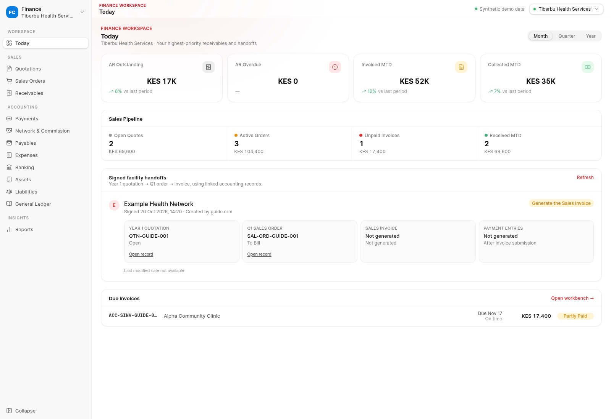

# Finance Cockpit Guide

**Audience:** Accounts Receivable and Finance operations\
**Start at:** `/finance-cockpit`\
**Your outcome:** follow signed facility work into native accounting records, review invoices, record receipts, and reconcile customer payment status.

*The dashboard uses synthetic company, handoff, KPI, and invoice data. Amounts and references are examples, not live accounting records.*

> Signed-facility handoffs in this guide belong to the separate
> invitation-only Network Opt-In process. Public Self-Onboarding ends when the
> owner accepts its Terms and submits a request; it has no signature or
> signatory step. Do not wait for a Self-Onboarding signature before following
> its next action in Customer Experience.

## Start with the right company and queue

1. Sign in with a role permitted to use the Finance Cockpit: **Administrator**, **Accounts User**, or **Accounts Manager**.
2. Open **Finance Cockpit** and confirm the selected company and currency before reviewing values.
3. Choose the due-invoice or signed-facility handoff queue that matches the work you are processing.
4. Search using the customer or facility name, then compare the Network and Opt-In submission reference.
5. Open the linked native document to inspect its current status and available actions.

If the company or customer is wrong, stop before submitting an accounting document. Correct the source relationship through the authorized CRM or ERPNext process.

## Follow a signed facility into accounting

The signed facility workflow can create a Year 1 quotation and Q1 Sales Order. Invoice creation depends on the Network's billing schedule, so a package selection, signed agreement, or Sales Order may exist before an invoice is due.

For each handoff:

1. Confirm the Opt-In is signed and the customer is the intended facility/Network party.
2. Open the linked quotation and review its items, quantities, taxes, and totals.
3. Open the linked Sales Order and confirm it references the expected quotation and customer.
4. Check the schedule or handoff explanation before expecting an invoice.
5. When an invoice is eligible, review its source order, posting state, due date, taxes, currency, and outstanding balance.
6. Use the linked document names when raising a discrepancy so CRM can trace the same facility request.

Do not create an invoice simply because you can see a package, an order, or a signed Opt-In. Follow the configured billing event and the Cockpit's offered action.

## Review and manage invoices

Use the invoice list to identify open, overdue, partially paid, and settled balances. Open an invoice and verify:

- The customer, facility, Network, and source Sales Order.
- The invoice number and posting state.
- The due date, currency, tax, grand total, and outstanding balance.
- Existing payment references or allocations.

An open invoice is eligible for customer payment through the payment option shown in Customer Experience. The Cockpit is where Accounts reviews the native Sales Invoice and its accounting state. If no invoice exists, check the Network billing schedule and the handoff explanation first.

## Record and allocate a receipt

When recording a receipt in the Finance Cockpit:

1. Select the correct customer and company.
2. Enter the amount actually received, date, payment method, and bank/cash account requested by the form.
3. Review the proposed invoice allocation. Match the receipt to the invoice using the customer and amount; do not allocate against a different facility's debt.
4. Submit the native Payment Entry only when the details are correct and your role permits submission.
5. Reopen the invoice and confirm that its outstanding balance reflects the allocation.
6. Keep any remaining amount visible as an outstanding balance or unapplied credit until it is correctly allocated.

A partial receipt reduces the invoice balance but does not settle the entire invoice. An overpayment can leave an unallocated credit; review it before treating the account as reconciled.

## Distinguish payment attempts from accounting receipts

A customer may start a M-Pesa or Paystack checkout from an open invoice. The checkout attempt can appear as **Pending verification** while the provider result is matched. That message does not mean the invoice is paid, and it is not a submitted Payment Entry.

Confirm the native Sales Invoice outstanding balance and submitted Payment Entry allocation before marking the receipt reconciled. If the provider says paid but no allocation appears, search by payment reference and invoice, then follow the reconciliation process. Avoid initiating another receipt or asking the customer to pay again until the first reference is resolved.

## Handle blocked work

| Situation | Finance action |
|---|---|
| Signed facility has no quotation/order | Confirm the signature trigger and linked CRM records; route the missing handoff with the submission reference. |
| Order exists but no invoice | Check whether the billing schedule makes it eligible. Do not manufacture an invoice. |
| Invoice amount or customer is wrong | Stop payment/receipt action and request correction at the source document. |
| Customer reports payment, invoice remains open | Match the provider reference to the invoice and inspect the Payment Entry/allocation state. |
| Receipt is partial | Submit the valid amount and leave the remaining invoice balance open. |
| Receipt exceeds the invoice | Review the unallocated amount as credit and follow the approved allocation process. |
| Duplicate or repeated payment reference | Preserve both references and resolve the original attempt before creating another receipt. |
| Finance Cockpit cannot load | Keep the native ERPNext documents intact; report the displayed reference and retry when the service recovers. |

## Stakeholder ownership

CRM owns Network and Opt-In context, signatures, and commercial handoff references. ERPNext owns quotations, Sales Orders, Sales Invoices, and Payment Entries. The Finance Cockpit operates on those native records under ERPNext permissions. Customer Experience shows the facility owner's allowed billing view and payment options. The implementation service separately owns HMIS deployment state.

Use **Administrator**, **Accounts User**, or **Accounts Manager** access as required by the Cockpit. A Sales role alone does not grant access to finance operations.

## Handoff

**CRM → Accounts:** signed submission, customer, facility, Network, Deal, quotation/order links, and billing schedule context.

**Accounts → Customer Experience:** posted invoice and allocated payment status for the facility owner to review.

**Accounts → CRM/Network:** source reference and explanation when a signed handoff, billing schedule, invoice, or customer identity needs correction.
